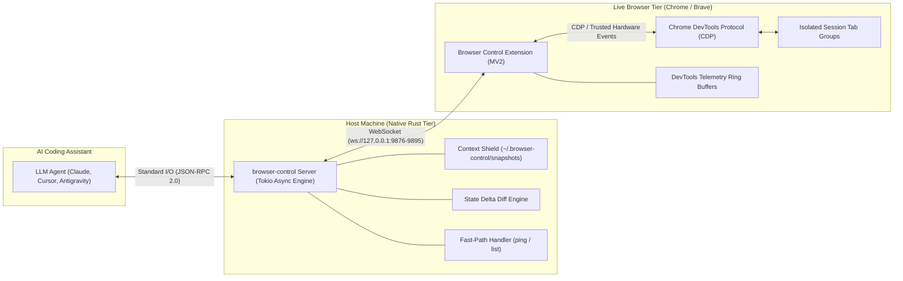
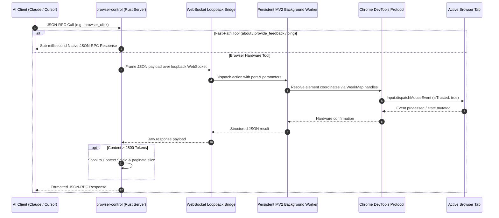
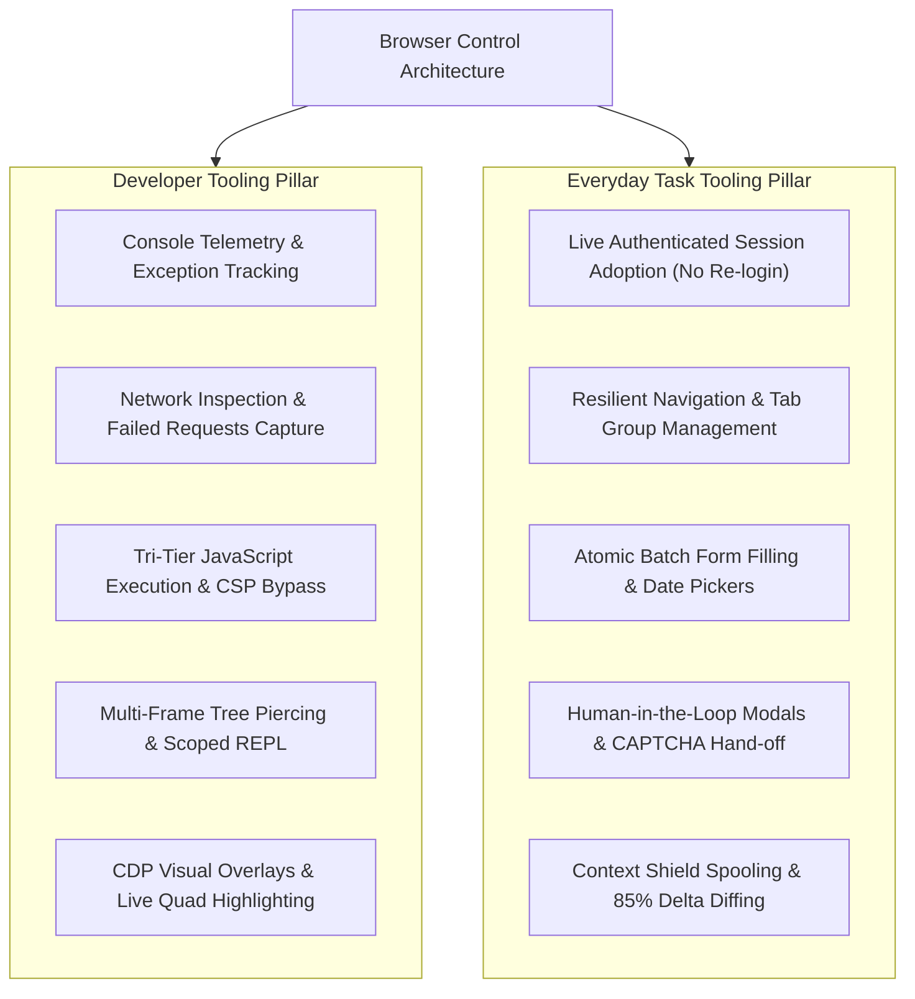

# Browser Control Architecture Specification

Standalone native Rust browser automation and developer-tools bridge for AI coding assistants (Claude Code, Cursor, Antigravity, OpenCode, Windsurf, VS Code).

> **Author**: Mohamed Elsheikh ([@modded-soldier-9](https://github.com/modded-soldier-9), moddedsoldier@gmail.com)  
> **Repository**: `browser-control` (formerly `browser-mcp`)  
> **Version**: 1.30.0  
> **Status**: Production Reference Architecture  

---

## 1. High-Altitude System Architecture

Browser Control bridges AI coding assistants to authenticated, live Chrome or Brave browser sessions using a **two-tier native hybrid model**:
1. **Tier 1 (Host)**: Ultra-lean compiled native Rust server (<4 ms boot, ~3.8 MB RAM, zero external runtime dependencies).
2. **Tier 2 (Browser)**: Persistent Manifest V2 WebExtension attached via loopback WebSocket, providing continuous DevTools CDP hardware control and multi-tenant tab isolation.



---

## 2. End-to-End Execution Flow



---

## 3. Core Subsystems

### 3.1 Stdio Transport & Decoupled Non-Blocking Event Loop
* **Location**: `crates/browser-mcp-server/src/main.rs`
* **Implementation Invariants**:
  * **Zero-Latency Stdio Loop**: Operates over standard input/output using newline-delimited JSON-RPC 2.0.
  * **Sub-Millisecond Fast-Path**: Direct routing processes `initialize`, `ping`, and `tools/list` immediately without polling or waiting on browser hardware dispatch.
  * **Asynchronous Queue Ordering**: Browser mutations execute through an async `mpsc` queue to prevent out-of-order race conditions on active DOM elements.
  * **Clean Process Termination**: Dedicated watchdog task tracks standard input EOF and OS termination signals (`SIGINT`, `SIGTERM`), ensuring clean shutdown without lingering orphan processes.

### 3.2 WebSocket Loopback Bridge & Origin Verification
* **Location**: `crates/browser-mcp-server/src/bridge.rs`
* **Implementation Invariants**:
  * **Dynamic Port Allocation**: Automatically scans and binds the first available loopback port in the range `127.0.0.1:9876` through `9895`.
  * **Strict Origin Authorization**: Rejects non-extension connections with `HTTP 401 Unauthorized` unless the handshake header matches `^chrome-extension://[a-p]{32}$`.
  * **Tiered Watchdog Timeouts**: Standard operations enforce a 30-second ceiling, while human-in-the-loop interactions (`browser_ask_user`) provide an extended 125-second window while keeping the stdio loop alive via responsive ping handling.

### 3.3 Context Shield & Token Protection
* **Location**: `crates/browser-mcp-server/src/shield.rs`
* **Implementation Invariants**:
  * **Automatic Payload Interception**: Any inspection payload exceeding 2,500 estimated tokens (~10,000 characters) is automatically intercepted.
  * **Local Spooling**: Spools the complete raw snapshot to `~/.browser-control/snapshots/tab_<id>_<timestamp>.txt`.
  * **In-Band Pagination & Metadata**: Emits an in-band paginated summary containing `total_tokens_approx`, `page_offset`, `limit`, and `spool_file` path.
  * **Deterministic LRU Eviction**: Maintains a strict storage budget capped at 50 snapshot files and 50 MB total disk usage.

### 3.4 State Delta Diff Engine
* **Location**: `crates/browser-mcp-server/src/delta.rs`
* **Implementation Invariants**:
  * **Symmetric Diffing**: When `format="delta"` is specified, computes line-based additions (`+ Added`) and subtractions (`- Removed`) relative to the prior tab snapshot.
  * **Navigation Invalidation**: Automatically clears historical state snapshots upon page navigation to guarantee diffs are never computed across unrelated domains.

### 3.5 Persistent Manifest V2 WebExtension Engine
* **Location**: `extension/background.js`
* **Implementation Invariants**:
  * **Persistent Background Lifecycle**: Operates under Manifest V2 to prevent the aggressive 30-second service-worker suspension typical of Manifest V3, ensuring continuous WebSocket connectivity.
  * **Session Tab Isolation**: Each client connection is mapped to a dedicated Chrome Tab Group with distinct color coding, isolating agent tabs from everyday personal browsing.
  * **Monotonic WeakMap Handles**: Interactive elements are tagged with monotonic tokens (`[e1]`, `[e2]`) anchored via JavaScript `WeakMap` (`__bmcpNodeMap`), preventing DOM pollution while maintaining stable identifiers across scrolls and re-renders.
  * **Physical Hardware Dispatch**: Resolves viewport coordinates and dispatches physical mouse/keyboard events via CDP `Input.dispatchMouseEvent` and `Input.dispatchKeyEvent` with `isTrusted: true`.

---

## 4. Dual-Pillar Capability Model

Browser Control provides unified capabilities tailored for both developer diagnostics and everyday user automation:



### 4.1 Professional Developer Workflows

1. **Console Telemetry & Exception Capture (`browser_console_logs`)**:
   - Maintains an in-memory ring buffer (up to 200 events) capturing `console.log`, `warn`, `error`, and `info`.
   - Captures uncaught runtime exceptions via CDP `Runtime.exceptionThrown` with call frames, line numbers, and timestamps.
2. **Network Inspection & Failed Requests Capture (`browser_get_failed_requests`, `browser_wait_for_network`)**:
   - Background ring buffer records all network transactions via CDP `Network.responseReceived` and `Network.loadingFailed`.
   - Instantly filters HTTP 4xx/5xx responses and aborted connections with sanitized headers and error status.
   - Intelligent network synchronization halts execution until in-flight requests settle.
3. **Tri-Tier Script Execution Pipeline (`browser_execute_script`)**:
   - *Tier 1 (Isolated World)*: Attempts `chrome.scripting.executeScript` inside extension isolated world.
   - *Tier 2 (Main World)*: Attempts execution within page global context to access application state.
   - *Tier 3 (CDP Runtime.evaluate Fallback)*: Directly invokes CDP runtime evaluation, bypassing strict page Content Security Policies (CSP). Automatically wraps top-level statements into asynchronous IIFEs and maps source URLs (`//# sourceURL=browser-control-script.js`).
4. **Hierarchical Frame Selection & Piercing (`browser_list_frames`, `browser_select_frame`)**:
   - Traverses nested iframe trees and provides index-based execution scoping, resolving cross-origin boundaries.
5. **Non-DOM Visual Highlighting (`browser_highlight`)**:
   - Uses CDP `Overlay.highlightQuad` and `Overlay.highlightRect` to render non-intrusive bounding highlights without altering page layout or DOM trees.

### 4.2 Everyday User Automation Workflows

1. **Live Browser Profile Adoption**:
   - Connects directly to the user's running Chrome or Brave session, preserving existing session cookies, enterprise SSO credentials, and authenticated states.
2. **Resilient Navigation & Tab Management (`browser_navigate`, `browser_list_tabs`, `browser_switch_tab`, `browser_close_tab`, `browser_get_new_tab`)**:
   - Tab reuse by default prevents tab bloat; automatic popup adoption links newly spawned child tabs back to the active session group.
3. **Atomic Form Auto-Fill (`browser_fill`, `browser_set_combobox`, `browser_set_date`, `browser_select_option`)**:
   - Batches multi-field form completion into single roundtrips with human-paced key intervals (35 ms).
   - Handles custom autocomplete widgets, ARIA comboboxes, and HTML5 date pickers.
4. **Human-in-the-Loop & Anti-Bot Hand-Off (`browser_ask_user`, `browser_handle_dialog`, `browser_solve_captcha`)**:
   - Injects non-intrusive modal overlays for credentials, 2FA codes, or human approval.
   - Automatically detects Cloudflare Turnstile, reCAPTCHA, and hCaptcha, signaling user takeover banners and resuming once resolved.
5. **Context Shield Token Protection**:
   - Protects LLM context windows by spooling large DOMs to disk while returning actionable accessibility tree slices (`[e1]`, `[e2]`).

---

## 5. Complete 43-Tool Surface Taxonomy

The 43 tools are organized into 8 functional domains with 100% parity across `tools_schema.json`, Rust `METHOD_MAP`, and `extension/background.js`:

| Domain | Tool Name | Dispatch Path | Primary Function |
| :--- | :--- | :--- | :--- |
| **1. Navigation & Tabs** | `browser_navigate` | WebSocket / CDP | Navigate active tab or spawn window with geometry |
| | `browser_list_tabs` | WebSocket / Extension | List open tabs belonging to active session |
| | `browser_switch_tab` | WebSocket / Extension | Focus tab by ID |
| | `browser_close_tab` | WebSocket / Extension | Close session tab by ID |
| | `browser_get_new_tab` | WebSocket / Extension | Adopt newly opened child tab |
| | `browser_reattach_debugger` | WebSocket / CDP | Force detach & reattach CDP session |
| | `browser_about` | Native Rust Fast-Path | Return server version, port, and connection telemetry |
| **2. Inspection & Shield** | `browser_get_page_content`| WebSocket / Shield | Extract text, HTML, snapshot, or delta with token spooling |
| | `browser_extract_list` | WebSocket / CDP | High-throughput structured list extraction |
| | `browser_search_elements` | WebSocket / DOM | Search elements by text query or role |
| | `browser_screenshot` | WebSocket / CDP | Capture visible viewport or element image |
| | `browser_dismiss_overlays`| WebSocket / DOM | Dismiss banners, modals, and backdrop overlays |
| | `browser_provide_feedback`| Native Rust Fast-Path | In-band feedback telemetry |
| **3. Hardware Input** | `browser_click` | WebSocket / CDP | Physical mouse click on selector or handle |
| | `browser_click_xy` | WebSocket / CDP | Physical mouse click at coordinate `(x, y)` |
| | `browser_double_click` | WebSocket / CDP | Double click with escalating click count |
| | `browser_right_click` | WebSocket / CDP | Context-menu right click |
| | `browser_hover` | WebSocket / CDP | Physical mouse hover at element coordinates |
| | `browser_fill` | WebSocket / CDP | Batch form filling with realistic pacing |
| | `browser_press_key` | WebSocket / CDP | Physical keyboard event with modifier flags |
| | `browser_scroll` | WebSocket / CDP | Directional or element-targeted viewport scroll |
| **4. Developer Diagnostics**| `browser_console_logs` | WebSocket / CDP | Telemetry ring buffer of console logs & errors |
| | `browser_get_failed_requests` | WebSocket / CDP | Ring buffer of HTTP 4xx/5xx & network aborts |
| | `browser_execute_script` | WebSocket / CDP | Tri-tier JavaScript evaluation with CSP bypass |
| | `browser_wait_for_network` | WebSocket / CDP | Wait for in-flight network activity to settle |
| | `browser_fetch` | WebSocket / Extension | Out-of-CORS HTTP request from browser context |
| **5. Frames & Visuals** | `browser_list_frames` | WebSocket / Extension | Enumerate hierarchical frame and iframe trees |
| | `browser_select_frame` | WebSocket / Scripting | Evaluate code scoped to specific iframe |
| | `browser_highlight` | WebSocket / CDP | Non-DOM visual highlight overlay |
| | `browser_wait` | WebSocket / DOM | Wait for selector, text, or DOM stillness |
| **6. Advanced Forms** | `browser_select_option` | WebSocket / DOM | Select option in native or custom select |
| | `browser_set_combobox` | WebSocket / CDP | Interact with ARIA combobox autocomplete |
| | `browser_set_date` | WebSocket / DOM | Set value on native or custom date inputs |
| | `browser_upload_file` | WebSocket / CDP | Attach file to native file input |
| | `browser_drop_file` | WebSocket / CDP | Drag-and-drop simulated file transfer |
| **7. Cookies & Storage** | `browser_get_cookies` | WebSocket / Extension | Retrieve domain cookies |
| | `browser_set_cookies` | WebSocket / Extension | Inject or mutate domain cookies |
| | `browser_get_local_storage`| WebSocket / Scripting | Read localStorage key-value pairs |
| | `browser_set_local_storage`| WebSocket / Scripting | Mutate localStorage key-value pairs |
| **8. Human-in-the-Loop** | `browser_ask_user` | WebSocket / Overlay | In-browser modal dialog requesting human input |
| | `browser_handle_dialog` | WebSocket / CDP | Handle native alert/confirm/prompt dialogs |
| | `browser_solve_captcha` | WebSocket / Overlay | Detect and manage anti-bot CAPTCHA hand-off |
| | `browser_extract_token` | WebSocket / Extension | Navigate to provider API key settings |

---

## 6. Communication Protocol & Wire Format

### 6.1 Stdio JSON-RPC 2.0 (Client to Rust Server)
Standard input/output communication adheres to JSON-RPC 2.0 specification:
```json
{
  "jsonrpc": "2.0",
  "id": 1,
  "method": "tools/call",
  "params": {
    "name": "browser_click",
    "arguments": {
      "selector": "[e3]"
    }
  }
}
```

### 6.2 Loopback WebSocket Frame (Server to Extension)
Payloads dispatched over `ws://127.0.0.1:9876-9895`:
```json
{
  "id": "req_84551f56",
  "method": "click",
  "params": {
    "selector": "[e3]"
  }
}
```

---

## 7. Security Architecture & Threat Model

1. **Origin Verification**: Every incoming WebSocket connection must supply an `Origin` header matching `^chrome-extension://[a-p]{32}$`. Non-matching origins are rejected immediately.
2. **Loopback Binding**: Bridge server binds exclusively to `127.0.0.1`, preventing any exposure to local networks or public interfaces.
3. **Snapshot Containment**: Spool directory paths are canonicalized and strictly contained within `~/.browser-control/snapshots/` to prevent directory traversal.
4. **Sanitized Telemetry**: Console logs and network request inspection redact sensitive HTTP authorization headers (`Authorization`, `Cookie`, `Set-Cookie`) in diagnostic outputs.

---

## 8. Verification & Architectural Invariants

* **Parity Enforcement**: Tools must maintain 100% agreement across:
  - Schema: `crates/browser-mcp-server/tools_schema.json`
  - Rust Dispatch: `crates/browser-mcp-server/src/tools.rs` (`METHOD_MAP`)
  - Extension Dispatch: `extension/background.js` (`dispatch` function switch cases)
* **Automated Gates**:
  - Parity Gate: `python scripts/verify_parity.py`
  - Documentation Gate: `python scripts/check-docs.py`
  - Test Suite: `cargo test --workspace`
  - Linting Gate: `cargo clippy --workspace --all-targets -- -D warnings`
  - Extension Asset Gate: `node scripts/build-extension.mjs`
