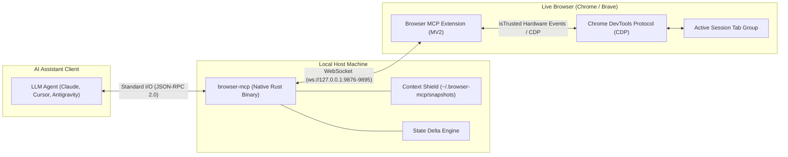

# Browser MCP Architecture

Browser MCP connects AI coding assistants (Claude Code, Cursor, Antigravity, OpenCode) to your live, authenticated Chrome or Brave browser sessions. It is designed around three architectural pillars: **zero external runtime dependencies**, **unbreakable keep-alive responsiveness**, and **aggressive LLM context protection**.

---

## High-Altitude System Architecture



---

## Core Subsystems

### 1. Stdio Transport & Non-Blocking Event Loop
* **Location**: `crates/browser-mcp-server/src/main.rs`
* **Invariants**:
  * Stdio communication uses newline-delimited JSON-RPC 2.0.
  * Fast-path routing handles `initialize`, `ping`, and `tools/list` on a sub-millisecond decoupled loop without waiting on browser hardware dispatch.
  * Browser mutations (clicks, fills, navigations) run sequentially through an async `mpsc` channel to prevent out-of-order race conditions on the DOM.
  * Process watchdog monitors stdin EOF and OS signals (`SIGINT`, `SIGTERM`), terminating cleanly with zero lingering background processes.

### 2. WebSocket Loopback Bridge & Origin Security
* **Location**: `crates/browser-mcp-server/src/bridge.rs`
* **Invariants**:
  * Automatically scans and binds the first available loopback port in range `127.0.0.1:9876` through `9895`.
  * Enforces strict `Origin` header validation against `^chrome-extension://[a-p]{32}$`. Non-extension origins are rejected with HTTP 401 Unauthorized.
  * Commands are tracked via oneshot channels and enforce individual timeouts (e.g., 30s standard, 125s for human-in-the-loop dialogs).

### 3. Context Shield & Token Protection
* **Location**: `crates/browser-mcp-server/src/shield.rs`
* **Invariants**:
  * Automatically intercepts inspection payloads exceeding 2,500 tokens (~10,000 characters).
  * Spools full raw snapshots to `~/.browser-mcp/snapshots/tab_<id>_<timestamp>.txt`.
  * Emits an in-band paginated slice with metadata (`total_tokens_approx`, `page_offset`, `limit`, `spool_file`) so agents can query specific lines or use targeted search.
  * Enforces an LRU cleaner maintaining a strict ceiling of max 50 files and max 50 MB total disk usage.

### 4. State Delta Engine
* **Location**: `crates/browser-mcp-server/src/delta.rs`
* **Invariants**:
  * When `format="delta"` is requested, computes symmetric line-based diffs (`+ Added`, `- Removed`) against the previous snapshot for that specific tab.
  * Automatically resets tab history upon navigation to avoid comparing cross-origin DOM trees.

### 5. Manifest V2 Extension & CDP Hardware Dispatch
* **Location**: `extension/background.js`
* **Invariants**:
  * Runs as a persistent background worker under Manifest V2, avoiding the 30-second service-worker idle disconnects of Manifest V3.
  * **Coordinate-Based Trusted Events**: `browser_click` and `browser_hover` resolve element coordinates and dispatch physical mouse events via CDP `Input.dispatchMouseEvent` (`isTrusted: true`), ensuring compatibility with modern React/Angular synthetic event systems.
  * **Monotonic Handles**: Element handles (`[e1]`, `[e2]`) are anchored via `WeakMap` (`__bmcpNodeMap`), ensuring element references remain stable across DOM re-renders and scrolling turns.
  * **Spatial Viewport Pruning (`viewport_only=true`)**: Prunes off-screen nodes (`rect.bottom >= 0 && rect.top <= window.innerHeight`) while keeping monotonic handles intact.

### 6. 43-Tool Surface Integration & Method Routing
* **Location**: `crates/browser-mcp-server/src/tools.rs` and `extension/background.js`
* **Invariants**:
  * **Fast-Path Local Routing**: Tools that do not require live browser DOM access (`browser_about` and `browser_provide_feedback`) execute locally in sub-millisecond native Rust code without loopback overhead.
  * **Bridge Hardware Routing**: The remaining 41 tools dispatch across loopback WebSocket to `extension/background.js` as CDP-backed or Chrome WebExtension actions.
  * **Domain Categorization**: The 43 tools span 7 functional domains: Navigation & Tab Management (7), DOM Inspection & Content Distillation (6), Hardware & Trusted Input (8), Forms, Dates & File Transfers (5), Storage, Cookies & Network State (7), Page Synchronization & Overlays (6), and Human-in-the-Loop & Advanced Automation (4).
  * **Prefix Normalization**: Tool names invoked with or without the `browser_` prefix are automatically normalized against `METHOD_MAP`.

---

## Directory Organization

```text
crates/browser-mcp-server/     # Rust standalone server binary & test harness
  src/main.rs                  # JSON-RPC dispatcher & stdio queue
  src/bridge.rs                # WebSocket bridge & loopback origin verification
  src/shield.rs                # Context Shield token counter & spooler
  src/delta.rs                 # State mutation delta diff engine
  src/tools.rs                 # 43 MCP tool definitions & METHOD_MAP
  src/sandbox.rs               # Filesystem path containment
  src/installer.rs             # Embedded extension extractor
  src/watchdog.rs              # Stdin EOF & termination watchdog
  tools_schema.json            # Canonical tool schema definitions
  tests/bridge_test.rs         # Server integration test suite

extension/                     # Chrome / Brave browser extension (MV2)
  background.js                # Core automation, CDP dispatch, semantic distillation
  offscreen.js                 # WebSocket client bridge connecting to localhost
  manifest.json                # Manifest V2 configuration
  popup.html / popup.js        # Extension connection status popup

examples/                      # Turnkey client configurations (Claude Desktop, Cursor, VS Code, Windsurf, Antigravity)
docs/                          # Static documentation website (browsermcp.dev)
content/                       # Markdown source documents for public docs
scripts/                       # Build, linting, and quality gate scripts
```
