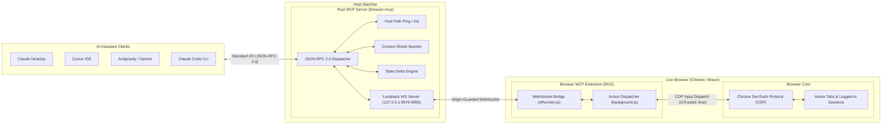

<p align="center">
  
</p>

# Browser MCP

<p align="center">
  <a href="https://github.com/modded-soldier-9/browser-mcp/actions/workflows/ci.yml"></a>
  <a href="https://github.com/modded-soldier-9/browser-mcp/releases"></a>
  <a href="LICENSE"></a>
  <a href="https://spec.modelcontextprotocol.io"></a>
  <a href="https://www.rust-lang.org/"></a>
  <a href="https://browsermcp.dev/"></a>
</p>

**Browser MCP** is a standalone, ultra-low-latency Rust [Model Context Protocol (MCP)](https://modelcontextprotocol.io/) server that connects AI coding assistants directly to your live, authenticated Chrome or Brave browser sessions.

Engineered and actively maintained by **Mohamed Elsheikh** ([@modded-soldier-9](https://github.com/modded-soldier-9)).

---

## Why Browser MCP?

Standard headless browser frameworks (Playwright, Puppeteer, Selenium) fail in real-world workflows: they break authenticated 2FA/SSO sessions, trigger Cloudflare anti-bot checks, and dump 30,000+ tokens of raw HTML into your LLM context window.

Browser MCP drives your everyday browser via a native compiled binary and persistent extension bridge:

- **Zero Runtime Dependencies**: Compiled standalone Rust binary (`browser-mcp`). Starts in **< 4 ms** and idles at **~3.8 MB RAM** without Node.js or Python runtime overhead.
- **Context Shield & Semantic Distillation**: Converts bloated DOM trees into 400–1,200 token accessibility snapshots with stable monotonic handles (`[e1]`, `[e2]`). Payloads exceeding 2,500 tokens automatically spool to disk snapshots with in-band pagination.
- **Spatial Viewport Pruning (`viewport_only=true`)**: Strips out-of-viewport elements, saving **50–70% tokens** on infinite-scroll feeds and dense enterprise portals.
- **Atomic Form Batching (`browser_fill`)**: Fills entire multi-field forms in a single atomic invocation (`fields: [{ selector, value }]`), cutting round-trip latency by 80%.
- **Targeted Element Discovery (`browser_search_elements`)**: Finds actionable buttons, links, or inputs by semantic label in **sub-100 tokens**.
- **State Mutation Deltas (`format="delta"`)**: Emits only added and removed DOM nodes after an action, slashing subsequent turn token consumption.
- **Loopback Origin Security**: Rejects unauthorized local connections by enforcing strict `Origin: chrome-extension://[a-p]{32}` verification on ports `127.0.0.1:9876–9895`.
- **43 Tools Green**: Comprehensive toolset covering tab lifecycle, hardware-level CDP interaction, storage, cookies, network inspection, and human-in-the-loop dialogs.

---

## Architecture

Browser MCP separates the stdio JSON-RPC transport from browser execution using a decoupled loopback bridge:



### Architecture Dataflow

```text
[ AI Assistant ]
      │  Standard I/O (JSON-RPC 2.0)
      ▼
[ browser-mcp Native Rust Binary ]
   ├── Stdio reader/writer with decoupled sub-millisecond ping loop
   ├── Context Shield: Token counting & snapshot spooling (~/.browser-mcp/snapshots)
   └── Loopback WebSocket server (127.0.0.1:9876-9895, Origin verification)
      │  WebSocket (JSON payload)
      ▼
[ Chrome / Brave Extension (Manifest V2) ]
   ├── offscreen.js: Persistent loopback WebSocket client
   └── background.js: Tab routing, WeakMap monotonic handles ([e1]), CDP dispatch
      │  Chrome DevTools Protocol (isTrusted: true)
      ▼
[ Live Browser Tab & DOM ]
```

---

## Quickstart

Setup takes under two minutes. Complete steps 1 and 2, then paste the configuration into your client of choice.

### 1. Install `browser-mcp`

#### Option A: Download Pre-built Binary (Recommended)
Download the latest executable for your OS from [GitHub Releases](https://github.com/modded-soldier-9/browser-mcp/releases), place `browser-mcp` in your system `PATH`, and run:
```bash
browser-mcp install
```

#### Option B: Build from Source (Rust 2024 / Cargo required)
```bash
git clone https://github.com/modded-soldier-9/browser-mcp.git
cd browser-mcp
cargo build --release --manifest-path crates/browser-mcp-server/Cargo.toml
./target/release/browser-mcp install
```

`browser-mcp install` automatically unpacks the companion browser extension into `~/.browser-mcp/extension/`.

---

### 2. Load the Extension in Your Browser

1. Navigate to `chrome://extensions` or `brave://extensions`.
2. Toggle **Developer mode** ON (top right corner).
3. Click **Load unpacked**.
4. Select the unpacked directory:
   - **macOS / Linux**: `~/.browser-mcp/extension`
   - **Windows**: `%USERPROFILE%\.browser-mcp\extension`

---

### 3. Client Configuration

Turnkey configurations for all major clients are provided in [`examples/`](examples/README.md). Add `browser-mcp` to your client configuration:

#### Claude Desktop
Add to your `claude_desktop_config.json`:
- **macOS**: `~/Library/Application Support/Claude/claude_desktop_config.json`
- **Windows**: `%APPDATA%\Claude\claude_desktop_config.json`
- **Linux**: `~/.config/Claude/claude_desktop_config.json`

```json
{
  "mcpServers": {
    "browser-mcp": {
      "command": "browser-mcp"
    }
  }
}
```

#### Cursor
Add to your project's `.cursor/mcp.json` or global Cursor settings (`~/.cursor/mcp.json`):

```json
{
  "mcpServers": {
    "browser-mcp": {
      "command": "browser-mcp"
    }
  }
}
```

#### Google Antigravity / Gemini CLI
Add to `~/.gemini/config/mcp_config.json`:

```json
{
  "mcpServers": {
    "browser-mcp": {
      "command": "browser-mcp"
    }
  }
}
```

#### Claude Code CLI
Register Browser MCP in one command:

```bash
claude mcp add browser-mcp -- browser-mcp
```

#### Generic Stdio MCP Clients (VS Code, Codex, Windsurf, Zed, Cline)
Any client supporting the Model Context Protocol stdio transport connects with:

```json
{
  "mcpServers": {
    "browser-mcp": {
      "command": "browser-mcp",
      "args": []
    }
  }
}
```

---

### 4. Verification

Make sure Chrome or Brave is running with the extension loaded, then invoke `browser_list_tabs`. A list of your open tabs confirms that the server, extension, and browser are fully synchronized.

---

## Tool Surface (43 Tools)

Browser MCP exposes 43 browser automation tools categorized by functional domain:

### 1. Navigation & Tab Management (7 tools)

| Tool | Description |
| :--- | :--- |
| `browser_navigate` | Navigates the active tab to a URL. Reuses the active tab by default; pass `new_tab=true` to preserve the current page. |
| `browser_list_tabs` | Lists all open browser tabs with their IDs, titles, and active URLs. |
| `browser_get_new_tab` | Retrieves the most recently opened tab (essential for popups, redirects, and OAuth windows). |
| `browser_switch_tab` | Switches active focus to a specific tab by ID. |
| `browser_close_tab` | Closes a tab owned by the active session. |
| `browser_list_frames` | Lists all iframes in the current page with frame IDs, URLs, and hierarchical indices. |
| `browser_select_frame` | Targets an iframe by index for scoped DOM execution. |

### 2. DOM Inspection & Content Distillation (6 tools)

| Tool | Description |
| :--- | :--- |
| `browser_get_page_content` | Extracts page content as accessible snapshot tree (`[e1]`, `[e2]`), text, or HTML with iframe traversal and automatic Context Shield spooling. |
| `browser_search_elements` | Searches actionable interactive elements by label, role, or text in sub-100 tokens, returning handles for instant clicking or filling. |
| `browser_extract_list` | Virtualized list extractor that scrolls containers incrementally until all rows are captured without DOM virtualization loss. |
| `browser_screenshot` | Captures viewport PNG screenshots, returned as base64 or saved directly to a local file path. |
| `browser_console_logs` | Inspects recent `console.log`, `warn`, and `error` messages via a lightweight runtime interceptor. |
| `browser_about` | Returns server metadata and pre-filled links for reporting bugs, feature wishes, or novel use-cases. |

### 3. Hardware & Trusted Input (8 tools)

| Tool | Description |
| :--- | :--- |
| `browser_click` | Clicks elements via CDP physical mouse events (`isTrusted: true`), supporting snapshot handles (`[e1]`), CSS selectors, and auto-clicking styled 0x0 toggles. |
| `browser_click_xy` | Escape hatch to dispatch trusted clicks at raw viewport CSS coordinates for stubborn canvas, map, or custom portal elements. |
| `browser_double_click` | Dispatches true double-clicks with escalating click counts for desktop-style file explorers and calendar apps. |
| `browser_right_click` | Triggers CDP right-clicks to display in-page custom web application context menus. |
| `browser_fill` | Enters text into input fields using Debugger injection across CSP-strict sites; supports multi-field batching via `fields: [{ selector, value }]`. |
| `browser_press_key` | Sends physical keyboard keystrokes (`Enter`, `Tab`, `Escape`, `ArrowDown`) with modifier key support (`ctrl`, `alt`, `shift`, `meta`). |
| `browser_hover` | Hovers over elements to trigger CSS hover states, tooltips, and flyout navigation menus. |
| `browser_scroll` | Scrolls a target element into view or scrolls the page viewport by relative pixel offsets. |

### 4. Forms, Dates & File Transfers (5 tools)

| Tool | Description |
| :--- | :--- |
| `browser_select_option` | Selects dropdown items across native `<select>` tags and modern component libraries (Angular Material, Radix, React Select). |
| `browser_set_combobox` | Automates autocomplete comboboxes by typing query text and selecting the filtered match. |
| `browser_set_date` | Reliably inputs dates into standard HTML5 date inputs and custom date pickers. |
| `browser_upload_file` | Attaches files to `<input type="file">` elements programmatically via CDP without opening OS file picker dialogs. |
| `browser_drop_file` | Simulates drag-and-drop file transfers onto dropzones that lack a visible `<input type="file">` tag. |

### 5. Storage, Cookies & Network State (7 tools)

| Tool | Description |
| :--- | :--- |
| `browser_get_cookies` | Retrieves cookies for the open tab's host domain and parent domains. |
| `browser_set_cookies` | Injects cookies for targeted testing, session spoofing, or authentication setup. |
| `browser_get_local_storage` | Reads specific keys or dumps all key-value entries from `localStorage`. |
| `browser_set_local_storage` | Writes key-value entries directly into `localStorage`. |
| `browser_extract_token` | Navigates directly to third-party developer settings to extract API tokens. |
| `browser_fetch` | Executes authenticated HTTP requests inside the browser session, inheriting cookies and bypassing CORS barriers. |
| `browser_get_failed_requests` | Inspects recent HTTP 4xx/5xx errors and network failures with credentials automatically redacted. |

### 6. Page Synchronization & Overlays (6 tools)

| Tool | Description |
| :--- | :--- |
| `browser_wait` | Blocks until a target element appears in the DOM or matches a specified selector. |
| `browser_wait_for_network` | Waits for in-flight fetch and XHR network connections to settle. |
| `browser_dismiss_overlays` | Dismisses cookie banners, consent prompts, newsletter popups, and modal backdrops in a single call. |
| `browser_handle_dialog` | Accepts or cancels native JavaScript `alert`, `confirm`, or `prompt` dialogs. |
| `browser_highlight` | Renders a non-destructive visual highlight box via the CDP compositor layer (`Overlay.highlightQuad`) without altering DOM markup. |
| `browser_reattach_debugger` | Reattaches the Chrome DevTools Protocol debugger to unblock frozen or orphaned sessions without restarting the extension. |

### 7. Human-in-the-Loop & Advanced Automation (4 tools)

| Tool | Description |
| :--- | :--- |
| `browser_ask_user` | Renders an in-browser modal dialog requesting human input for OTP codes, 2FA prompts, or credentials. |
| `browser_solve_captcha` | Detects and assists in solving CAPTCHAs (Cloudflare Turnstile, reCAPTCHA v2/v3, hCaptcha) with automated clicking and human fallback. |
| `browser_execute_script` | Executes arbitrary JavaScript in the page context with top-level `await` support. |
| `browser_provide_feedback` | Self-diagnostic tool that verifies extension connectivity, checks for multi-extension conflicts, and generates pre-filled GitHub issues. |

---

## Security & Privacy

1. **Local-Only Communication**: All communication between the `browser-mcp` binary and the browser extension occurs exclusively over local loopback (`127.0.0.1:9876–9895`). No telemetry, analytics, or third-party servers are contacted.
2. **Strict Origin Enforcement**: The WebSocket server strictly validates that the connecting client's `Origin` matches `chrome-extension://[a-p]{32}`, rejecting unauthorized local processes.
3. **Sandbox Path Validation**: File upload tools (`browser_upload_file`) enforce path confinement checks to ensure that files referenced reside inside authorized working directories.
4. **Credential Redaction**: Network inspection tools automatically redact sensitive cookies, tokens, and authorization headers from diagnostic output.

---

## Troubleshooting

### Extension Not Connected
- Ensure Chrome or Brave is running.
- Verify that **Developer mode** is enabled under `chrome://extensions` and that the extension at `~/.browser-mcp/extension` is enabled.
- If you have multiple profiles or reload the extension, invoke `browser_reattach_debugger` or restart your AI assistant.

### Debugger Conflicts
Only one debugger can attach to a browser tab at a time. If Chrome DevTools is open on the tab being automated, close the DevTools panel or use a separate tab.

### Inspect Connection Status
Click the **Browser MCP** extension icon in your browser toolbar to view the live WebSocket connection status, active port, and connected client information.

---

## Author & Maintainer

Created, engineered, and actively maintained by **Mohamed Elsheikh** ([@modded-soldier-9](https://github.com/modded-soldier-9)).

Contributions, issues, and feature requests are welcome! Feel free to check the [issues page](https://github.com/modded-soldier-9/browser-mcp/issues) or use `browser_about` to submit feedback directly from your AI workflow.

---

## License

Released under the [MIT License](LICENSE). Copyright © 2026 **Mohamed Elsheikh**.
