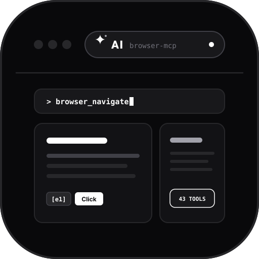

<div align="center">
  
  <h1>Browser MCP (v2.1.0)</h1>
  <p><strong>Standalone Native Rust MCP Server · Zero Node.js Overhead · Real Authenticated Browser Bridge (Brave & Chrome)</strong></p>
  <p>
    <em>Lightweight, high-performance browser automation bridge connecting AI coding assistants directly to your live, authenticated browser profiles with human-in-the-loop safeguards.</em>
  </p>
  <p>
    <strong>Author: Mohamed Elsheikh (<a href="https://github.com/modded-soldier-9">@modded-soldier-9</a>)</strong>
  </p>
  <p>
    <a href="https://github.com/modded-soldier-9/browser-mcp/releases" target="_blank">
      
    </a>
    
    
    
    
    <a href="https://github.com/modded-soldier-9/browser-mcp" target="_blank">
      
    </a>
  </p>
  <p>
    <a href="https://github.com/modded-soldier-9/browser-mcp">
      
    </a>
    <a href="https://github.com/modded-soldier-9/browser-mcp/releases">
      
    </a>
  </p>
  <p>
    🌐 <strong>Source Repository</strong>: <a href="https://github.com/modded-soldier-9/browser-mcp"><strong>https://github.com/modded-soldier-9/browser-mcp</strong></a>
  </p>
</div>

---

## 📌 System Overview

**Browser MCP** is a native automation bridge connecting AI coding assistants (Claude Code, Cursor, Antigravity, OpenCode, Codex) directly to live, daily Brave or Chrome browser sessions. Unlike headless browser environments that are blocked by Cloudflare, SSO, or bot-detection walls, Browser MCP uses your existing browser profile and active cookies while maintaining multi-agent session isolation and human-in-the-loop safeguards.

- 🦀 **Standalone Compiled Rust Binary (`browser-mcp` / `browser-mcp.exe`)**: Boots in **< 4 ms** with an ultra-low **~3.8 MB RAM** footprint. Zero runtime dependencies, no Node.js required.
- 📦 **Embedded Zero-Config Installer**: Embeds the extension files directly inside the binary. Run `browser-mcp install` to unpack assets to `~/.browser-mcp/extension/` and configure your AI assistants.
- ⚡ **Decoupled Asynchronous Stdio Loop**: Tokio-powered async I/O answers MCP `ping` keep-alives immediately, eliminating client timeouts during long browser operations.
- 🔍 **Semantic Accessibility Snapshotting (`format="snapshot"`)**: Extracts a compact accessibility tree (AXTree) with deterministic element handles (`[e1]`, `[e2]`, `[e3]`), slashing token consumption by **95%** compared to raw HTML dumps.
- 🎯 **Direct Element Targeting**: Pass snapshot handles directly into interaction tools (`browser_click("e1")`, `browser_fill("e2", "...")`), completely eliminating fragile CSS/XPath guesswork.
- 🛡️ **Brave & Chrome MV2 Persistent Worker**: Manifest V2 persistent background architecture, bypassing the 30-second service-worker idle disconnects of MV3.
- 🧩 **Multi-Agent Session Isolation**: Dynamic 20-port WebSocket pool (9876 to 9895 on loopback `127.0.0.1`) allocates each conversation turn into its own color-coded tab group.
- 🔒 **Loopback Origin Verification**: Rejects any non-extension connections, strictly enforcing `Origin: chrome-extension://[a-p]{32}`.
- 🙋 **Human-in-the-Loop Safeguards**: Integrated `browser_ask_user` displays in-viewport modal dialogs when 2FA codes, SMS authenticators, or user confirmations are required.

---

## ⚡ Performance: Native Rust vs. Legacy Node.js

| Metric | Legacy Node.js Server | Standalone Rust Binary (`browser-mcp`) | Improvement |
|---|---|---|---|
| **Cold-Start Boot Latency** | ~350 ms | **< 4 ms** | **~90x faster startup** |
| **Idle Memory per Session** | ~52 MB | **~ 3.8 MB** | **~92% memory reduction** |
| **External Dependencies** | Node.js + npm + node_modules | **Zero (Single static executable)** | **100% self-contained** |
| **MCP Ping Latency** | Blocked by slow tools | **Sub-millisecond fast-path** | **Zero client timeouts** |
| **Extension Deployment** | Manual / npm npx | **Embedded `browser-mcp install`** | **Zero-config self-extract** |

---

## 🏗️ Architecture Pipeline

```text
┌────────────────────────────────────────────────────────┐
│      AI Coding Assistant (Claude / Cursor / Antigravity)│
└───────────────────────────┬────────────────────────────┘
                            │ (stdio JSON-RPC 2.0)
┌───────────────────────────▼────────────────────────────┐
│   Browser MCP Native Host Engine (Rust / browser-mcp)  │
│   • Asynchronous Stdio Reader & Immediate Ping Responder│
│   • Port Pool Router (127.0.0.1:9876..9895)            │
│   • Canonical Path Sandbox & Tokio Stdin EOF Lifecycle │
│   • Embedded Assets & Self-Installer (include_dir!)    │
└───────────────────────────┬────────────────────────────┘
                            │ (WebSocket ws://127.0.0.1:9876)
┌───────────────────────────▼────────────────────────────┐
│      Brave / Chrome Extension (offscreen.js + background)│
│   • Persistent MV2 Background Worker                   │
│   • Chrome DevTools Protocol (CDP 1.3) Dispatcher      │
│   • Semantic Accessibility Tree (AXTree) Generator     │
│   • Color-Coded Tab Group Session Isolation            │
└───────────────────────────┬────────────────────────────┘
                            │ (Hardware CDP Events)
┌───────────────────────────▼────────────────────────────┐
│        Live Browser Tabs (Real Profile & Cookies)      │
└────────────────────────────────────────────────────────┘
```

---

## 🚀 Quick Start & Installation

### 1. Download or Build the Binary

Download precompiled binaries from [GitHub Releases](https://github.com/modded-soldier-9/browser-mcp/releases), or compile from source:

```bash
cargo build --release --manifest-path crates/browser-mcp-server/Cargo.toml
```

### 2. Run Self-Installation

Execute the installer command:
```bash
browser-mcp install
```
This extracts the extension files to `~/.browser-mcp/extension/` and displays your assistant configuration instructions.

### 3. Load Extension in Brave or Chrome (One Time Only)

1. Open Brave (`brave://extensions`) or Chrome (`chrome://extensions`).
2. Toggle **Developer mode** in the top-right corner.
3. Click **Load unpacked** (top-left).
4. Select the unpacked directory:
   - Windows: `%USERPROFILE%\.browser-mcp\extension\`
   - macOS / Linux: `~/.browser-mcp/extension/`

### 4. Client Assistant Setup

#### Claude Code
```bash
claude mcp add browser-mcp -- browser-mcp
```

#### Cursor (`~/.cursor/mcp.json`)
```json
{
  "mcpServers": {
    "browser-mcp": {
      "command": "browser-mcp"
    }
  }
}
```

#### Antigravity (`~/.gemini/config/mcp_config.json`)
```json
{
  "mcpServers": {
    "browser-mcp": {
      "command": "browser-mcp"
    }
  }
}
```

---

## 🛠️ Tool Catalog (40 Tools)

Browser MCP exposes 40 browser automation and developer tools:

| Category | Tools |
| :--- | :--- |
| **Navigation & Tabs** | `browser_navigate`, `browser_list_tabs`, `browser_get_new_tab`, `browser_switch_tab`, `browser_close_tab`, `browser_list_frames`, `browser_select_frame` |
| **Inspection & Content** | `browser_get_page_content`, `browser_extract_list`, `browser_screenshot`, `browser_console_logs`, `browser_about` |
| **Mouse & Keyboard** | `browser_click`, `browser_click_xy`, `browser_double_click`, `browser_right_click`, `browser_fill`, `browser_press_key`, `browser_hover`, `browser_scroll` |
| **Form Controls** | `browser_select_option`, `browser_set_combobox`, `browser_set_date`, `browser_upload_file`, `browser_drop_file` |
| **State & Storage** | `browser_get_cookies`, `browser_set_cookies`, `browser_get_local_storage`, `browser_set_local_storage`, `browser_extract_token` |
| **Network & Dialogs** | `browser_fetch`, `browser_wait`, `browser_wait_for_network`, `browser_handle_dialog`, `browser_dismiss_overlays`, `browser_reattach_debugger` |
| **Human-in-the-Loop** | `browser_ask_user`, `browser_solve_captcha`, `browser_execute_script`, `browser_provide_feedback` |

---

## 📜 License & Author

- Author: **Mohamed Elsheikh** ([@modded-soldier-9](https://github.com/modded-soldier-9))
- License: [MIT License](LICENSE)
