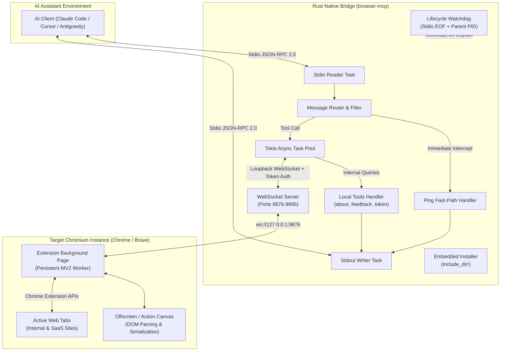

# Standalone Rust Browser MCP Architecture & Modernization

*   **Author:** Mohamed Elsheikh (@modded-soldier-9)
*   **Status:** Draft
*   **Date:** 2026-10-31

--------------------------------------------------------------------------------

## Overview

Browser MCP is a high-performance native automation bridge written in Rust that connects local AI coding assistants (Claude Code, Cursor, Antigravity, OpenCode, Codex) directly to live, authenticated browser profiles in Chrome and Brave. By driving the user's primary or dedicated development browser via a low-restriction Manifest V2 extension, it bypasses cloud anti-bot challenges (Cloudflare, CAPTCHAs, bot detection) and enterprise SSO barriers, enabling AI agents to inspect DOM state, extract runtime data, capture visual snapshots, and execute authenticated developer workflows.

This architecture transitions the codebase from a dual-runtime Node.js/Rust fork into a single standalone native binary (`browser-mcp`). It eliminates runtime dependencies, bundles extension assets for single-command installation, purges legacy Danish technical debt, hardens WebSocket security boundaries, and standardizes multi-platform distribution via GitHub Releases.

## The Problem

1. **Dual-Runtime Maintenance Overhead**: The repository maintains two parallel server implementations: legacy Node.js (`mcp-server/index.js`) and Rust (`crates/browser-mcp-server`). This duplicates tool schemas, splits bug fixes, and requires a 50+ MB Node.js runtime environment for end users.
2. **Critical Rust Server Bugs**:
   - *Flawed Watchdog*: `main.rs:63` monitors its own process ID (`std::process::id()`) instead of the caller's parent PID, and ignores the shutdown channel. Orphaned server instances persist indefinitely after host assistant exits, holding TCP ports 9876–9895.
   - *Stdio Starvation*: Synchronous stdio line reads block the entire runtime loop during slow tools (`browser_ask_user`, `browser_extract_list`), dropping MCP `ping` heartbeats and triggering client timeouts.
   - *Missing Local Handlers*: `tools.rs` routes server-local commands (`browser_about`, `browser_provide_feedback`, `browser_extract_token`) across WebSockets to the extension where no handlers exist.
3. **Localhost WebSocket Attack Surface**: The loopback WebSocket bridge accepts any connection matching the extension origin pattern without pre-shared authentication, exposing active browser sessions and auth cookies to untrusted local processes.
4. **No Standalone Installation**: The Rust binary stubs `--install` as a no-op, forcing users to rely on npm.
5. **Danish Technical Debt**: Pervasive Danish variable names, comments, and scripts across `mcp-server/vagt.js`, `maaling/`, `scripts/flow-daekning.sh`, and `test/` hinder open-source maintenance.

## Goals

1. **Standalone Native Binary**: Compile a single zero-dependency executable (`browser-mcp` / `browser-mcp.exe`) in Rust as the sole server runtime, replacing Node.js completely.
2. **Embedded Self-Installation**: Embed Manifest V2 extension assets directly into the binary with `include_dir!`, enabling zero-config deployment via `browser-mcp install` for Claude Code, Cursor, Antigravity, and OpenCode.
3. **Loopback WebSocket Security**: Enforce pre-shared cryptographic handshake token authentication between the Rust server and the extension.
4. **Decoupled Asynchronous Stdio Loop**: Process stdio messages with Tokio asynchronous tasks, guaranteeing immediate responses to MCP `ping` requests while long-running browser commands execute.
5. **Correct Process Lifecycle Management**: Detect parent process termination reliably via stdio pipe EOF and active parent PID tracking, terminating orphaned instances cleanly.
6. **100% English Codebase**: Purge all Danish files, comments, identifiers, and tests, standardizing on clear technical English.

## Non-Goals

1. **Extension WebAssembly Rewrite**: The Chrome extension will remain vanilla JavaScript; rewriting it in Rust/Wasm adds build complexity without tangible benefit.
2. **Headless Browser Emulation**: Browser MCP will not simulate headless browser runs (Playwright/Puppeteer domain). It exists specifically for live, user-authenticated browser sessions.
3. **Manifest V3 Migration**: The extension will retain Manifest V2 to prevent 30-second service worker idle disconnects, recommending Brave and Chrome Developer/Beta channels.
4. **In-Binary Auto-Update Daemon**: Binary updates will be managed via package managers or direct release downloads, not background daemon auto-updaters.

## Open Questions

*   **Question 1 (Token Passing to MV2 Extension)**: When `browser-mcp` generates a session secret token, how should the extension discover it? Options include: local config file written to extension storage, query parameter during initial port probe, or clipboard/prompt handoff.
*   **Question 2 (Tool Surface Rationalization)**: Should mouse click variants (`browser_click_xy`, `browser_double_click`, `browser_right_click`) be merged into `browser_click` in this milestone, or deferred to a subsequent schema update to preserve backward compatibility with existing prompt workflows?

## Critical User Journeys (CUJs)

### CUJ 1: Zero-Dependency Setup
*   **Given**: A developer with Claude Code or Cursor and Brave installed, with no Node.js runtime on their machine.
*   **When**: The user downloads the `browser-mcp` binary from GitHub Releases and executes `browser-mcp install`.
*   **Then**: The binary writes the extension files to `~/.browser-mcp/extension/`, detects installed AI assistants, updates client configuration files (`~/.cursor/mcp.json`, Claude config), prints extension load instructions, and exits with code 0.

### CUJ 2: Authenticated Web App Debugging with 2FA
*   **Given**: An AI coding assistant running `browser-mcp` needs to verify a change on an internal dashboard protected by SSO and 2FA.
*   **When**: The agent calls `browser_navigate` to the portal and triggers `browser_ask_user` for the human 2FA prompt.
*   **Then**: The Rust server handles incoming MCP `ping` requests asynchronously while waiting up to 120 seconds for the user response, preventing client timeouts, and returns the authenticated session state upon completion.

### CUJ 3: Clean Termination on Client Exit
*   **Given**: Claude Code or Cursor crashes or closes its terminal window.
*   **When**: The stdio pipe attached to `browser-mcp` reaches EOF.
*   **Then**: The Rust server detects pipe closure immediately, broadcasts a shutdown signal, closes WebSocket listener ports (9876–9895), and terminates cleanly without leaving orphaned processes.

--------------------------------------------------------------------------------

## Technical Plan (Architecture)

### Architectural Overview

Browser MCP operates as a high-throughput, low-latency bridge between AI coding assistants and active Chromium browser windows. The architecture separates concerns into two core tiers:
1. **Host-Side Native Server (`browser-mcp`)**: A lightweight compiled Rust binary executed by the AI client over standard I/O using the Model Context Protocol (MCP JSON-RPC 2.0).
2. **Browser-Side Controller (`extension/`)**: A persistent Manifest V2 WebExtension loaded into Chrome or Brave that exposes native browser automation primitives via loopback WebSockets.

### Subsystems and Module Architecture

#### 1. Decoupled Asynchronous Stdio Engine (`main.rs`, `protocol.rs`)
*   **The Problem Addressed**: Synchronous line-by-line reading blocks during long-running tool executions (`browser_ask_user` waiting for 2FA or `browser_extract_list` traversing massive trees), starving MCP `ping` keep-alives and causing host timeouts.
*   **Implementation**:
    *   `tokio::io::BufReader<tokio::io::Stdin>` runs in a dedicated reader loop emitting parsed JSON-RPC requests across an unbounded mpsc channel.
    *   Incoming `ping` requests bypass the tool worker queue entirely: the router responds with `{"jsonrpc":"2.0","id":...,"result":{}}` directly to the stdout writer channel in sub-millisecond time.
    *   Tool execution calls are dispatched onto asynchronous Tokio tasks using `tokio::spawn`, allowing concurrent execution and non-blocking I/O.
    *   A centralized `tokio::io::Stdout` writer task serializes all outgoing frames, preventing interleaved stdout corruption.

#### 2. Loopback WebSocket Bridge with Token Authentication (`bridge.rs`)
*   **Port Pool Negotiation**: Retains the dynamic port scanning range `9876..=9895` on `127.0.0.1` to support multiple simultaneous server instances and browser profiles without collisions.
*   **Handshake Security**:
    *   At startup, the server generates a cryptographically secure 32-character hex session token (`auth_token`).
    *   The token is stored in the user runtime directory (`~/.browser-mcp/session.token`) with strict OS permissions (`0600` on POSIX, ACL restricted to current user on Windows).
    *   Incoming WebSocket connection requests must provide this token via query parameter (`ws://127.0.0.1:9876?token=...`) or WebSocket subprotocol headers.
    *   Connections lacking a valid token or originating outside loopback are terminated immediately before any payload processing.
*   **Request Correlation**: Outgoing browser commands assign monotonically increasing IDs mapped to `tokio::sync::oneshot::Sender<Value>` channels in an active request registry with timeout enforcement.

#### 3. Local vs. Remote Tool Dispatcher (`tools.rs`)
*   **Local Tool Execution**: Tools that query server metadata or interact with the local host are handled natively in Rust without WebSocket dispatch:
    *   `browser_about`: Returns server version, runtime platform, active WebSocket port, and connected extension status.
    *   `browser_provide_feedback`: Writes local diagnostic logs and telemetry notes directly to disk.
    *   `browser_extract_token`: Extracts session tokens locally from disk cache or environment variables.
*   **Remote Extension Dispatch**: Browser automation tools (`browser_navigate`, `browser_click`, `browser_fill`, `browser_screenshot`, `browser_ask_user`, `browser_get_page_content`, etc.) serialize the tool payload and dispatch it to the extension over the authenticated WebSocket bridge.

#### 4. Parent Process Watchdog & Self-Termination (`watchdog.rs`)
*   **Root Cause Fix**: Eliminates the inverted self-PID check (`std::process::id()`) in `main.rs:63`.
*   **Dual-Vector Termination**:
    1.  *Stdio EOF (Primary)*: When the host client terminates, the stdin pipe closes. Tokio's `read_line` yields `Ok(0)`, which triggers an immediate graceful shutdown broadcast.
    2.  *Parent PID Tracker (Fallback)*: On Windows and Linux, the server captures its parent process ID upon startup. A low-overhead periodic check (every 5 seconds) verifies that the parent PID remains alive without invoking full-system process scanning. If the parent dies, the server terminates cleanly.

#### 5. Embedded Assets & Self-Installer (`installer.rs`)
*   **Asset Bundling**: The entire `extension/` directory is bundled into the compiled binary at compile time via `include_dir::include_dir!("$CARGO_MANIFEST_DIR/../../extension")`.
*   **Installation Command (`browser-mcp install`)**:
    1.  Extracts the bundled extension files into `~/.browser-mcp/extension/`.
    2.  Detects installed AI coding assistants by checking standard configuration paths:
        *   Cursor: `~/.cursor/mcp.json` or `%APPDATA%/Cursor/User/globalStorage/mcp.json`
        *   Claude Code: `~/.claude.json` / `claude mcp add browser-mcp <path>`
        *   Antigravity: `~/.gemini/config/mcp_config.json`
        *   OpenCode: `~/.config/opencode/opencode.json`
    3.  Appends or updates the `browser-mcp` entry pointing to the executable path.
    4.  Outputs clear instructions for loading the unpacked extension in Chrome/Brave (`chrome://extensions` -> "Load unpacked" -> `~/.browser-mcp/extension`).

#### 6. Tool Schema Standardization & English Normalization (`tools_schema.json`)
*   Renames all remaining non-English parameter identifiers to standard English:
    *   `eget_vindue` -> `new_window`
    *   `fokuser` -> `focus`
    *   `vindue_x` -> `x`
    *   `vindue_bredde` -> `width`
    *   `vindue_hoejde` -> `height`
*   Ensures consistent error payloads (`{"error": {"code": -32602, "message": "..."}}`) for invalid parameters across all 40 tools.

--------------------------------------------------------------------------------

## Alternatives Considered

### Alternative 1: Dual-Engine Architecture (Node.js npm package + Rust binary)

*   **Pros**: Retains backward compatibility for users accustomed to `npx browser-mcp install` without compiling or downloading native binaries.
*   **Cons**:
    *   Doubles maintenance overhead by requiring synchronizing tool schemas, WebSocket protocols, and bug fixes across two language runtimes.
    *   Maintains the 50+ MB Node.js runtime footprint and dependency vulnerabilities in `package.json`.
    *   Dilutes project focus away from building an optimized, native-first Rust tool.
*   **Reason for Rejection**: The primary goal is to own the project and eliminate runtime dependencies. Decommissioning Node.js cuts code bloat, improves startup latency, and establishes a single canonical implementation.

### Alternative 2: Immediate Migration to Chrome Manifest V3

*   **Pros**: Fully aligns with upcoming Chrome Web Store distribution policies and modern Chromium standards.
*   **Cons**:
    *   MV3 service workers are aggressively terminated by Chromium after 30 seconds of inactivity.
    *   During long agent reasoning turns or complex prompt generation, the service worker terminates, destroying active WebSocket connections and dropping session context.
    *   Workarounds (e.g., MV3 Offscreen Documents or keep-alive audio tricks) introduce fragile complexity and higher CPU usage.
*   **Reason for Rejection**: Manifest V2 background scripts remain persistently loaded without idle disconnects. Because Browser MCP is designed for local developer automation—primarily via Brave or developer Chrome channels—MV2 provides far superior connection reliability.

### Alternative 3: Chrome Native Messaging Host instead of WebSocket Bridge

*   **Pros**:
    *   Eliminates open loopback TCP ports (9876–9895), avoiding potential port conflicts.
    *   Removes the need for a pre-shared WebSocket authentication token.
*   **Cons**:
    *   Requires writing OS-specific registry entries on Windows (`HKCU\Software\Google\Chrome\NativeMessagingHosts`) and filesystem manifests on macOS/Linux.
    *   Requires elevated permissions or fragile installer scripts that often break in non-standard environments.
    *   Tightly couples the binary to a single browser instance, preventing multiple client assistants from attaching to different tabs or profiles.
*   **Reason for Rejection**: A loopback WebSocket bridge provides platform-agnostic, zero-privilege operation across Windows, macOS, and Linux without touching system registries. Adding cryptographic token verification resolves the security exposure cleanly.

### Alternative 4: Full-System Process Polling via `sysinfo` for Watchdog

*   **Pros**: Simple cross-platform library abstraction for scanning parent process status.
*   **Cons**:
    *   Iterating over the entire OS process table every 5 seconds creates persistent CPU churn and battery drain.
    *   Adds several hundred kilobytes of compiled dependencies to the binary.
*   **Reason for Rejection**: Stdio pipe EOF handling in Tokio detects client exit with zero CPU overhead. Combining stdin EOF with a direct OS parent handle check provides superior reliability with zero process table scanning.

--------------------------------------------------------------------------------

## Non-Functional Requirements

### Security & Privacy
*   **Loopback Binding**: The WebSocket bridge and any internal sockets must bind strictly to `127.0.0.1` and never expose ports to `0.0.0.0` or external network interfaces.
*   **Cryptographic Handshake**: The session handshake token must be generated via cryptographically secure random bytes (32-character hex string) and restricted by operating system file permissions (`0600` POSIX / current user ACL Windows).
*   **Origin Enforcement**: WebSocket connections must reject any origin header that does not strictly match the expected Chrome/Brave extension pattern (`chrome-extension://[a-p]{32}`).
*   **Credential Handling**: Browser cookies, localStorage values, and DOM tokens extracted by tools must never be logged to stdout or unencrypted local telemetry logs.

### Performance & Latency
*   **Startup Latency**: Server cold startup to readiness must complete in under 5 milliseconds (<4 MB resident memory).
*   **Stdio Throughput**: Fast-path MCP `ping` requests must return responses in under 1 millisecond regardless of active tool executions.
*   **Binary Size**: The release binary (with extension assets embedded) should remain under 12 MB uncompressed and under 4 MB compressed with UPX/zstd.

### Rollout & Compatibility
*   **Client Compatibility**: Full compliance with the official Model Context Protocol (MCP) JSON-RPC 2.0 specification, ensuring compatibility with Claude Code, Cursor, Antigravity, OpenCode, and Codex.
*   **Cross-Platform Targets**: Precompiled release binaries for:
    *   Windows (`x86_64-pc-windows-msvc`)
    *   macOS Apple Silicon (`aarch64-apple-darwin`)
    *   macOS Intel (`x86_64-apple-darwin`)
    *   Linux x86_64 (`x86_64-unknown-linux-musl`)
    *   Linux ARM64 (`aarch64-unknown-linux-musl`)

--------------------------------------------------------------------------------

### Additional Resources

*   Model Context Protocol (MCP) Specification: `https://spec.modelcontextprotocol.io`
*   Chromium Manifest V2 Extension APIs: `https://developer.chrome.com/docs/extensions/mv2/`
*   Tokio Asynchronous Runtime: `https://tokio.rs/`

### Future Improvements

*   **Manifest V3 Offscreen Adapter**: Abstract the extension message broker to allow seamless transition to Chrome Manifest V3 using Offscreen Documents if MV2 support is permanently retired across all Chromium derivatives.
*   **Native DevTools CDP Multiplexing**: Directly attach Chrome DevTools Protocol (CDP) debugging streams for real-time network request interception and performance profiling.

--------------------------------------------------------------------------------

## Detailed Implementation Plan

### Target Files to Create, Modify, or Delete

#### 1. `crates/browser-mcp-server/Cargo.toml` (Modify)
*   **Type / Scope**: Rust Package Manifest
*   **Proposed Changes**:
    *   Update crate name to `browser-mcp`, version to `2.1.0`, description, repository, and author metadata.
    *   Add `include_dir = "0.7"` for compile-time asset embedding.
    *   Add `rand = "0.8"` for secure token generation.
    *   Evaluate removing `sysinfo` to reduce binary size and eliminate full-process scanning overhead.
    *   Configure release profile with `opt-level = 3`, `lto = true`, `codegen-units = 1`, and `strip = true`.

#### 2. `crates/browser-mcp-server/src/main.rs` (Modify)
*   **Type / Scope**: Server Entrypoint & Stdio Engine
*   **Proposed Changes**:
    *   Implement decoupled asynchronous stdio handling with separate Tokio reader and writer tasks communicating over mpsc channels.
    *   Intercept MCP `ping` messages immediately in the reader task and route responses directly to the writer channel.
    *   Replace stubbed `--install` argument with call to `installer::run_install()`.
    *   Add `--port` and `--token` optional CLI flags for manual debugging.
    *   Fix watchdog integration: wire shutdown broadcast receiver to gracefully terminate all active Tokio tasks when the parent process exits.

#### 3. `crates/browser-mcp-server/src/protocol.rs` (Modify)
*   **Type / Scope**: JSON-RPC 2.0 & MCP Types
*   **Proposed Changes**:
    *   Define strict strongly-typed structs for MCP request, response, error, tool call, and capability objects.
    *   Implement serialization/deserialization helpers for standard JSON-RPC 2.0 error codes (`-32700`, `-32600`, `-32601`, `-32602`, `-32603`).
    *   Provide instant JSON constructor for `ping` results.

#### 4. `crates/browser-mcp-server/src/bridge.rs` (Modify)
*   **Type / Scope**: Loopback WebSocket Server
*   **Proposed Changes**:
    *   Implement loopback port scanning across range `9876..=9895`.
    *   Generate a 32-character hex authentication token at startup, write it to `~/.browser-mcp/session.token`, and enforce token matching on incoming WebSocket upgrade handshakes.
    *   Manage bidirectional request correlation using `Arc<Mutex<HashMap<u64, oneshot::Sender<Value>>>>` with configurable execution timeouts.
    *   Provide broadcast channel to notify connected extensions during server shutdown.

#### 5. `crates/browser-mcp-server/src/tools.rs` (Modify)
*   **Type / Scope**: Tool Execution Registry & Local Router
*   **Proposed Changes**:
    *   Implement local execution logic for `browser_about` (returns runtime metadata, port, extension status).
    *   Implement local execution logic for `browser_provide_feedback` (persists feedback payload to local log).
    *   Implement local execution logic for `browser_extract_token` (reads active session token).
    *   Dispatch all remaining browser automation tools to the WebSocket bridge.
    *   Translate Danish parameter mapping in dispatch handlers (`eget_vindue` -> `new_window`, etc.).

#### 6. `crates/browser-mcp-server/src/tools_schema.json` (Modify)
*   **Type / Scope**: MCP Tool Schema Catalog
*   **Proposed Changes**:
    *   Rename all remaining Danish parameter names across all 40 tool schemas to English (`new_window`, `focus`, `x`, `width`, `height`).
    *   Clean up descriptions and standardize property requirements across all tool definitions.

#### 7. `crates/browser-mcp-server/src/installer.rs` (Create)
*   **Type / Scope**: Self-Installation Module
*   **Proposed Changes**:
    *   Embed `extension/` directory at compile time via `include_dir::include_dir!("$CARGO_MANIFEST_DIR/../../extension")`.
    *   Implement `run_install()`:
        *   Create destination directory `~/.browser-mcp/extension/` and extract all embedded files.
        *   Detect installed AI coding assistants by checking filesystem paths for Claude Code, Cursor, Antigravity, and OpenCode.
        *   Automatically inject or update the `browser-mcp` executable configuration in corresponding JSON config files.
        *   Output clear terminal guidance on enabling Developer Mode in Chrome/Brave and loading `~/.browser-mcp/extension/`.

#### 8. `crates/browser-mcp-server/src/watchdog.rs` (Modify)
*   **Type / Scope**: Lifecycle & Process Monitoring
*   **Proposed Changes**:
    *   Remove erroneous `std::process::id()` self-monitoring.
    *   Capture caller parent PID upon server startup.
    *   Implement lightweight periodic check verifying parent PID liveness.
    *   Tie watchdog trigger directly to the Tokio shutdown broadcast channel.

#### 9. `crates/browser-mcp-server/tests/bridge_test.rs` (Create)
*   **Type / Scope**: Native Rust Integration Tests
*   **Proposed Changes**:
    *   Test WebSocket server binding and multi-instance port discovery.
    *   Test token authentication handshake (reject missing token, accept valid token).
    *   Test local execution of `browser_about` without connected extension.
    *   Test stdio JSON-RPC ping parsing and response formatting.

#### 10. `extension/manifest.json` (Modify)
*   **Type / Scope**: Extension Manifest
*   **Proposed Changes**:
    *   Update extension name, description, author, and repository link to English and fork branding.
    *   Verify Manifest V2 permissions (`tabs`, `cookies`, `webRequest`, `storage`, `<all_urls>`).

#### 11. `extension/background.js` (Modify)
*   **Type / Scope**: Background Extension Controller
*   **Proposed Changes**:
    *   Purge all Danish variable names (`alleePorteOptaget`, `sikrePort`, `loesPortLoefte`, `ledErDoedt`, `forfaedreKaede`) and Danish comments.
    *   Read authentication token from query parameter or local storage when initiating WebSocket connection to `ws://127.0.0.1:9876`.
    *   Handle server disconnect and reconnect backoff gracefully.

#### 12. `extension/offscreen.js` (Modify)
*   **Type / Scope**: DOM Canvas & Parsing Worker
*   **Proposed Changes**:
    *   Purge Danish comments and error strings, translating everything to standard English.

#### 13. `extension/popup.js` & `extension/popup.html` (Modify)
*   **Type / Scope**: Extension UI Popup
*   **Proposed Changes**:
    *   Standardize all UI labels, status messages, and diagnostics to English.
    *   Display connected server port and authentication status clearly.

#### 14. Purged Directories & Files (Delete)
*   **Type / Scope**: Legacy Technical Debt Removal
*   **Proposed Changes**:
    *   Delete `mcp-server/` directory entirely (Node.js runtime, duplicate schemas, `node_modules`).
    *   Delete `runbrowsermcpupdate.sh`.
    *   Delete `scripts/flow-daekning.sh`.
    *   Delete `scripts/konkurrent-vagt.py`.
    *   Delete `scripts/npm-oidc-tjek.py`.
    *   Delete `scripts/beviskort.sh` and `scripts/byg-mcpb.sh`.
    *   Rename `maaling/` to `benchmarks/` and translate scripts (`latens.mjs` -> `latency.mjs`, `hvad.mjs` -> `inspect.mjs`).
    *   Delete `test/aerlighed/` and `test/hjaelp/`.

#### 15. `.github/workflows/release.yml` (Create)
*   **Type / Scope**: CI/CD Automation
*   **Proposed Changes**:
    *   Create GitHub Actions workflow triggered on tag pushes (`v*`).
    *   Matrix build across Windows (`x86_64-pc-windows-msvc`), macOS (`x86_64-apple-darwin`, `aarch64-apple-darwin`), and Linux (`x86_64-unknown-linux-musl`, `aarch64-unknown-linux-musl`).
    *   Package binaries with tar.gz / zip archives and publish directly to GitHub Releases.

#### 16. `README.md` & `CLAUDE.md` (Modify)
*   **Type / Scope**: Documentation & Developer Guide
*   **Proposed Changes**:
    *   Rewrite `README.md` in English with modern branding, quickstart guide via `browser-mcp install`, tool reference, and architecture summary.
    *   Update `CLAUDE.md` dev commands to reference Cargo exclusively.

### Verification Plan

*   **Compilation/Build**:
    *   `cargo check --manifest-path crates/browser-mcp-server/Cargo.toml`
    *   `cargo build --release --manifest-path crates/browser-mcp-server/Cargo.toml`
*   **Unit & Integration Tests**:
    *   `cargo test --manifest-path crates/browser-mcp-server/Cargo.toml`
*   **Self-Installation Verification**:
    *   `cargo run --manifest-path crates/browser-mcp-server/Cargo.toml -- install`
    *   Verify `~/.browser-mcp/extension/manifest.json` exists and matches bundled assets.
*   **Token Handshake Verification**:
    *   Start server, verify `~/.browser-mcp/session.token` is generated with 32 characters.
    *   Connect WebSocket without token -> verify connection closed immediately.
    *   Connect WebSocket with token -> verify connection established successfully.
*   **Stdio Keep-Alive Verification**:
    *   Send `{"jsonrpc":"2.0","id":1,"method":"ping"}` -> verify immediate `{"jsonrpc":"2.0","id":1,"result":{}}` response while a simulated 5-second command is executing.
*   **EGM Verification**:
    *   Run `python scripts/check-docs.py` to ensure tool documentation integrity across all markdown contracts.

--------------------------------------------------------------------------------

*Drafted with EGM*
