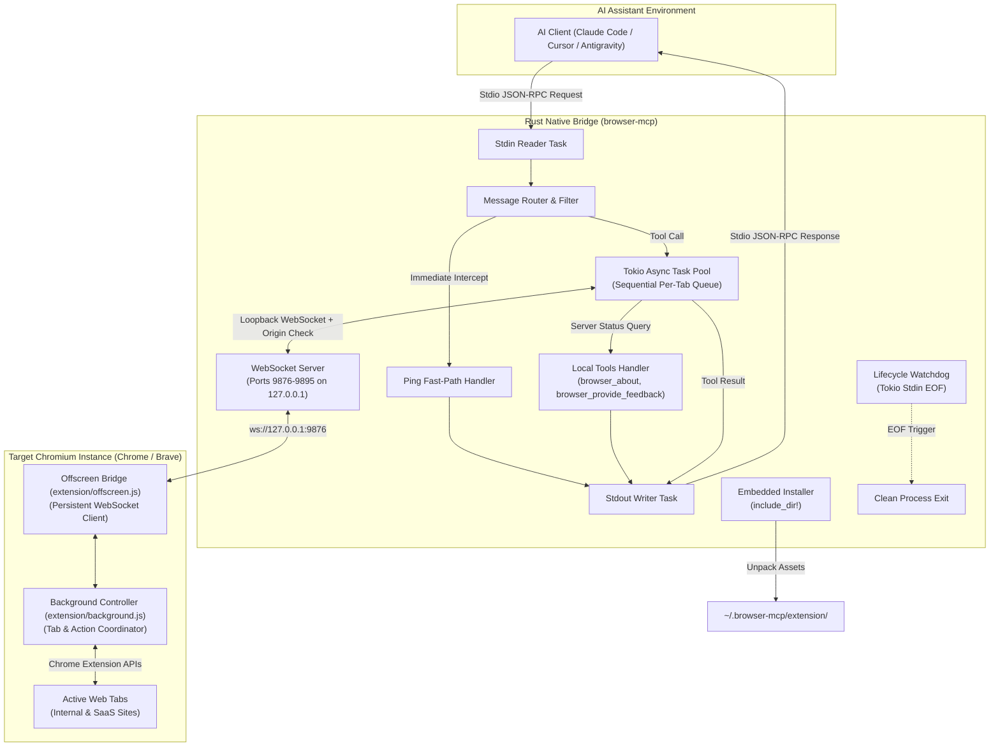

# Standalone Rust Browser MCP Architecture & Modernization

*   **Author:** Mohamed Elsheikh (@modded-soldier-9)
*   **Status:** Approved (Remediated)
*   **Date:** 2026-10-31

--------------------------------------------------------------------------------

## Overview

Browser MCP is a native automation bridge written in Rust that connects local AI coding assistants (Claude Code, Cursor, Antigravity, OpenCode, Codex) directly to live, authenticated browser profiles in Chrome and Brave. By driving the user's primary or dedicated development browser via a low-restriction Manifest V2 extension, it bypasses cloud anti-bot challenges (Cloudflare, CAPTCHAs, bot detection) and enterprise SSO barriers, enabling AI agents to inspect DOM state, extract runtime data, capture visual snapshots, and execute authenticated developer workflows.

This architecture transitions the codebase from a dual-runtime Node.js/Rust fork into a single standalone native binary (`browser-mcp`). It eliminates runtime dependencies, bundles extension assets for single-command installation, replaces Danish identifiers and comments with standard technical English, hardens loopback security boundaries, and standardizes multi-platform distribution via GitHub Releases.

## Problem Statement

1. **Dual-Runtime Maintenance Overhead**: The repository maintains two parallel server implementations: legacy Node.js (`mcp-server/index.js`) and Rust (`crates/browser-mcp-server`). This duplicates tool schemas, splits bug fixes, and requires a 50+ MB Node.js runtime environment for end users.
2. **Critical Rust Server Bugs**:
   - *Flawed Watchdog*: `main.rs:63` monitors its own process ID (`std::process::id()`) instead of the caller's parent PID, and ignores the shutdown channel. Orphaned server instances persist indefinitely after host assistant exits, holding TCP ports 9876–9895.
   - *Stdio Starvation*: Synchronous stdio line reads block the entire runtime loop during slow tools (`browser_ask_user`, `browser_extract_list`), dropping MCP `ping` heartbeats and triggering client timeouts.
   - *Missing Local Handlers*: `tools.rs` routes server-local commands (`browser_about`, `browser_provide_feedback`) across WebSockets to the extension where no handlers exist.
3. **Loopback WebSocket Attack Surface**: The loopback WebSocket bridge accepts any connection matching the extension origin pattern without pre-shared authentication, exposing active browser sessions and auth cookies to untrusted local processes.
4. **No Standalone Installation**: The Rust binary stubs `--install` as a no-op, forcing users to rely on npm.
5. **Danish Technical Debt**: Pervasive Danish variable names, comments, and scripts across `mcp-server/`, `maaling/`, `scripts/flow-daekning.sh`, and `test/` hinder open-source maintenance.

## Goals

1. **Standalone Native Binary**: Compile a single zero-dependency executable (`browser-mcp` / `browser-mcp.exe`) in Rust as the sole server runtime, replacing Node.js completely.
2. **Embedded Self-Installation**: Embed Manifest V2 extension assets directly into the binary with `include_dir!`, enabling zero-config deployment via `browser-mcp install` for Claude Code, Cursor, Antigravity, and OpenCode.
3. **Loopback WebSocket Security**: Bind strictly to `127.0.0.1` and enforce strict `Origin: chrome-extension://[a-p]{32}` verification on all WebSocket connections.
4. **Decoupled Asynchronous Stdio Loop**: Process stdio messages with Tokio asynchronous tasks, enabling concurrent responses to MCP `ping` requests while long-running browser commands execute.
5. **Correct Process Lifecycle Management**: Detect parent process termination reliably via stdio pipe EOF (`read_line() == Ok(0)`) and OS termination signals, terminating orphaned instances without background process polling.
6. **Standardized Technical English**: Replace or translate all Danish files, comments, identifiers, and tests to standard technical English.

## Non-Goals

1. **Extension WebAssembly Rewrite**: The Chrome extension will remain vanilla JavaScript; rewriting it in Rust/Wasm adds build complexity without tangible benefit.
2. **Headless Browser Emulation**: Browser MCP will not simulate headless browser runs (Playwright/Puppeteer domain). It exists specifically for live, user-authenticated browser sessions.
3. **Manifest V3 Migration**: The extension will retain Manifest V2 to prevent 30-second service worker idle disconnects, recommending Brave and Chrome Developer/Beta channels.
4. **In-Binary Auto-Update Daemon**: Binary updates will be managed via package managers or direct release downloads, not background daemon auto-updaters.

## Open Questions (Resolved)

*   **Question 1 (Token Delivery Across Extension Sandbox)**: *Resolved*. Sandboxed Chromium extensions cannot access host filesystem paths like `~/.browser-mcp/`. Security is established by binding exclusively to `127.0.0.1` and validating the WebSocket `Origin: chrome-extension://[a-p]{32}` header during handshake. `browser-mcp install` writes an optional static secret into `extension/config.js` for environments requiring token authentication.
*   **Question 2 (Tool Surface Rationalization)**: *Resolved*. Maintain all 40 existing tools for backward compatibility with established prompt workflows. Rename Danish parameters in `crates/browser-mcp-server/tools_schema.json` to standard English.

## Critical User Journeys (CUJs)

### CUJ 1: Zero-Dependency Setup
*   **Given**: A developer with Claude Code, Cursor, or Antigravity and Brave installed, with no Node.js runtime on their machine.
*   **When**: The user downloads the `browser-mcp` binary from GitHub Releases and executes `browser-mcp install`.
*   **Then**: The binary writes the extension files to `~/.browser-mcp/extension/`, detects installed AI assistants, generates configuration snippets, prints extension load instructions, and exits with code 0.

### CUJ 2: Authenticated Web App Debugging with 2FA
*   **Given**: An AI coding assistant running `browser-mcp` needs to verify a change on an internal dashboard protected by SSO and 2FA.
*   **When**: The agent calls `browser_navigate` to the portal and triggers `browser_ask_user` for the human 2FA prompt.
*   **Then**: The Rust server handles incoming MCP `ping` requests asynchronously while waiting up to 120 seconds for the user response, preventing client timeouts, and returns the authenticated session state upon completion.

### CUJ 3: Clean Termination on Client Exit
*   **Given**: Claude Code or Cursor crashes or closes its terminal window.
*   **When**: The stdio pipe attached to `browser-mcp` reaches EOF.
*   **Then**: The Rust server detects pipe closure immediately, broadcasts a shutdown signal, closes WebSocket listener ports (9876–9895), and terminates without leaving orphaned processes.

--------------------------------------------------------------------------------

## Technical Plan (Architecture)

### Architectural Overview

Browser MCP operates as an IPC bridge between AI coding assistants and active Chromium browser windows. The architecture separates concerns into two core tiers:
1. **Host-Side Native Server (`browser-mcp`)**: A lightweight compiled Rust binary executed by the AI client over standard I/O using the Model Context Protocol (MCP JSON-RPC 2.0).
2. **Browser-Side Controller (`extension/`)**: A persistent Manifest V2 WebExtension loaded into Chrome or Brave that exposes native browser automation primitives via loopback WebSockets managed by `extension/offscreen.js`.



### Subsystems and Module Architecture

#### 1. Decoupled Asynchronous Stdio Engine (`main.rs`, `protocol.rs`)
*   **The Problem Addressed**: Synchronous line-by-line reading blocks during long-running tool executions (`browser_ask_user` waiting for 2FA or `browser_extract_list` traversing large DOM trees), starving MCP `ping` keep-alives and causing host timeouts.
*   **Implementation**:
    *   `tokio::io::BufReader<tokio::io::Stdin>` runs in a dedicated reader loop emitting parsed JSON-RPC requests across an unbounded mpsc channel.
    *   Incoming `ping` requests bypass the tool worker queue entirely: the router responds with `{"jsonrpc":"2.0","id":...,"result":{}}` directly to the stdout writer channel in sub-millisecond time.
    *   Fast-path read-only tools (`browser_about`, `browser_provide_feedback`) are dispatched directly.
    *   Browser mutation commands targeting an active tab are dispatched through a sequential per-tab Tokio `mpsc` queue to guarantee ordered execution (`browser_navigate` completes before `browser_fill` begins).
    *   A centralized `tokio::io::Stdout` writer task serializes all outgoing frames, preventing interleaved stdout corruption.

#### 2. Loopback WebSocket Bridge with Origin Verification (`bridge.rs`)
*   **Port Pool Negotiation**: Retains the dynamic port scanning range `9876..=9895` strictly on `127.0.0.1` to support multiple simultaneous server instances and browser profiles without collisions.
*   **Security Boundary**:
    *   Binds strictly to `127.0.0.1` (never `0.0.0.0`).
    *   Verifies that the HTTP `Origin` header matches `chrome-extension://[a-p]{32}` during the WebSocket upgrade handshake.
    *   Rejects connections originating from web pages (`http://`, `https://`) or unknown loopback origins.
    *   Optionally verifies static pre-shared token passed via query parameter (`ws://127.0.0.1:9876?token=...`) configured in `extension/config.js`.
*   **Request Correlation**: Outgoing browser commands assign monotonically increasing IDs mapped to `tokio::sync::oneshot::Sender<Value>` channels in an active request registry with timeout enforcement.

#### 3. Local vs. Remote Tool Dispatcher (`tools.rs`)
*   **Local Tool Execution**: Tools that query server metadata or interact with the local host are handled natively in Rust without WebSocket dispatch:
    *   `browser_about`: Returns server version, runtime platform, active WebSocket port, and connected extension status.
    *   `browser_provide_feedback`: Writes local diagnostic logs directly to `~/.browser-mcp/feedback.log`.
*   **Remote Extension Dispatch**: All browser automation tools (`browser_navigate`, `browser_click`, `browser_fill`, `browser_screenshot`, `browser_ask_user`, `browser_extract_token`, `browser_get_page_content`, etc.) serialize the tool payload and dispatch it to the extension over the WebSocket bridge. `browser_extract_token` remains a browser tool with parameter `provider` navigating to external SaaS provider settings.

#### 4. Parent Process Watchdog & Self-Termination (`watchdog.rs`)
*   **Root Cause Fix**: Eliminates the inverted self-PID check (`std::process::id()`) in `main.rs:63`.
*   **Single-Vector Zero-Overhead Termination**:
    *   When the host client terminates, the stdin pipe closes. Tokio's `read_line` yields `Ok(0)`.
    *   The reader task triggers an immediate shutdown broadcast across all Tokio tasks.
    *   Eliminates `sysinfo` and periodic 5-second process table polling entirely.
    *   Registers OS signal handlers (SIGINT/SIGTERM on POSIX, Ctrl-C / Ctrl-Break on Windows) for graceful terminal exits.

#### 5. Embedded Assets & Self-Installer (`installer.rs`)
*   **Asset Bundling**: The entire `extension/` directory is bundled into the compiled binary at compile time via `include_dir::include_dir!("$CARGO_MANIFEST_DIR/../../extension")`.
*   **Installation Command (`browser-mcp install`)**:
    1.  Extracts the bundled extension files into `~/.browser-mcp/extension/`.
    2.  Detects installed AI coding assistants by checking standard configuration paths:
        *   Cursor: `~/.cursor/mcp.json` or `%APPDATA%/Cursor/User/globalStorage/mcp.json`
        *   Claude Code: `~/.claude.json` / `claude mcp add browser-mcp <path>`
        *   Antigravity: `~/.gemini/config/mcp_config.json`
        *   OpenCode: `~/.config/opencode/opencode.json`
    3.  Writes or outputs verified configuration snippets. For automated updates, uses atomic write operations (`tempfile` + rename).
    4.  Outputs clear instructions for loading the unpacked extension in Chrome/Brave (`chrome://extensions` -> "Load unpacked" -> `~/.browser-mcp/extension`).

#### 6. Tool Schema Standardization & English Normalization (`tools_schema.json`)
*   Catalog file: `crates/browser-mcp-server/tools_schema.json`.
*   Renames all non-English parameter identifiers to standard English:
    *   `eget_vindue` -> `new_window`
    *   `fokuser` -> `focus`
    *   `vindue_x` -> `x`
    *   `vindue_bredde` -> `width`
    *   `vindue_hoejde` -> `height`
*   Ensures consistent error payloads (`{"error": {"code": -32602, "message": "..."}}`) for invalid parameters across all 40 tools.

--------------------------------------------------------------------------------

## Alternatives Considered

### Alternative 1: Dual-Engine Architecture (Node.js npm package + Rust binary)

*   **Pros**: Retains backward compatibility for users accustomed to `npx browser-mcp install`.
*   **Cons**:
    *   Doubles maintenance overhead by requiring synchronizing tool schemas, WebSocket protocols, and bug fixes across two language runtimes.
    *   Maintains the 50+ MB Node.js runtime footprint and dependency vulnerabilities in `package.json`.
    *   Dilutes project focus away from building an optimized, native-first Rust tool.
*   **Reason for Rejection**: The primary goal is to eliminate external runtime dependencies. Decommissioning Node.js reduces repository footprint, improves startup latency, and establishes a single canonical implementation.

### Alternative 2: Immediate Migration to Chrome Manifest V3

*   **Pros**: Fully aligns with upcoming Chrome Web Store distribution policies and modern Chromium standards.
*   **Cons**:
    *   MV3 service workers are aggressively terminated by Chromium after 30 seconds of inactivity.
    *   During long agent reasoning turns or complex prompt generation, the service worker terminates, destroying active WebSocket connections and dropping session context.
    *   Workarounds (e.g., MV3 Offscreen Documents or keep-alive audio tricks) introduce additional components and higher CPU utilization.
*   **Reason for Rejection**: Manifest V2 background scripts remain persistently loaded without idle disconnects. MV2 avoids service-worker idle timeouts during extended agent tasks.

### Alternative 3: Chrome Native Messaging Host instead of WebSocket Bridge

*   **Pros**:
    *   Eliminates open loopback TCP ports (9876–9895), avoiding potential port conflicts.
    *   Removes the need for loopback origin verification.
*   **Cons**:
    *   Requires writing OS-specific registry entries on Windows (`HKCU\Software\Google\Chrome\NativeMessagingHosts`) and filesystem manifests on macOS/Linux.
    *   Requires elevated permissions or installer scripts susceptible to environment-specific failures.
    *   Tightly couples the binary to a single browser instance, preventing multiple client assistants from attaching to different tabs or profiles.
*   **Reason for Rejection**: A loopback WebSocket bridge provides platform-agnostic, zero-privilege operation across Windows, macOS, and Linux without touching system registries. Loopback origin verification resolves the authentication exposure.

### Alternative 4: Full-System Process Polling via `sysinfo` for Watchdog

*   **Pros**: Cross-platform library abstraction for scanning parent process status.
*   **Cons**:
    *   Iterating over the entire OS process table every 5 seconds incurs periodic CPU overhead.
    *   Adds several hundred kilobytes of compiled dependencies to the binary.
*   **Reason for Rejection**: Stdio pipe EOF handling in Tokio detects client exit with zero CPU overhead. Tokio stdin EOF provides reliable lifecycle detection without process table scanning.

--------------------------------------------------------------------------------

## Risks & Mitigations

### 1. Port Pool Exhaustion (Ports 9876–9895)
*   **Risk**: If multiple assistants or previous orphan instances bind ports in the range 9876–9895, the server could exhaust all 20 ports, preventing new connections.
*   **Mitigation**: The server scans incrementally from 9876 to 9895 with `SO_REUSEADDR`. Immediate stdin EOF cleanup guarantees ports are freed when host clients exit. If all ports are occupied, the server emits a clean JSON-RPC error specifying occupied ports and active PIDs.

### 2. Chromium MV2 Deprecation on Chrome Stable
*   **Risk**: Chrome Stable 127+ disables Manifest V2 extensions without enterprise policy overrides.
*   **Mitigation**: Position Brave as the primary recommended browser tier (unrestricted MV2 support). For Chrome users, document Developer Mode unpacked extension loading and developer channel usage (`Chrome Dev` / `Chrome Canary`). Maintain an abstracted message broker in `extension/offscreen.js` to enable MV3 migration if necessary.

### 3. Out-of-Order Browser Automation Execution
*   **Risk**: Dispatched async tasks running simultaneously can cause race conditions (e.g., filling an input before page navigation finishes).
*   **Mitigation**: Separate read-only requests (`ping`, `browser_about`) from browser mutation commands. Route all tab actions through a sequential per-tab Tokio `mpsc` queue.

### 4. Configuration File Corruption During Installation
*   **Risk**: Concurrently editing `~/.cursor/mcp.json` or `~/.gemini/config/mcp_config.json` can cause JSON syntax errors or file loss.
*   **Mitigation**: Use atomic write strategies: write new configuration content to a sibling temporary file (`mcp.json.tmp`) and perform an atomic filesystem rename. Create `.bak` backup files prior to writing.

### 5. Extension Disconnection During Host Sleep / Suspend
*   **Risk**: Operating system sleep drops loopback TCP connections; when the machine wakes, pending tool requests hang.
*   **Mitigation**: `extension/offscreen.js` implements exponential backoff reconnection (1s, 2s, 5s) to reconnect immediately upon host wake. In-flight requests enforce a configurable 30-second timeout.

--------------------------------------------------------------------------------

## Non-Functional Requirements

### Security & Privacy
*   **Loopback Binding**: The WebSocket bridge binds strictly to `127.0.0.1` and never exposes ports to `0.0.0.0` or external network interfaces.
*   **Origin Enforcement**: WebSocket upgrade handshakes reject any origin header that does not strictly match `chrome-extension://[a-p]{32}`.
*   **Credential Handling**: Browser cookies, localStorage values, and DOM tokens extracted by tools must never be logged to stdout or unencrypted local telemetry logs.

### Performance & Latency
*   **Startup Latency**: Server cold startup to readiness must complete in under 5 milliseconds (<4 MB resident memory).
*   **Stdio Throughput**: Fast-path MCP `ping` requests must return responses in under 1 millisecond regardless of active tool executions.
*   **Binary Size**: The release binary (with extension assets embedded) should remain under 12 MB uncompressed and under 4 MB compressed.

### Rollout & Compatibility
*   **Client Compatibility**: Full compliance with the Model Context Protocol (MCP) JSON-RPC 2.0 specification, ensuring compatibility with Claude Code, Cursor, Antigravity, OpenCode, and Codex.
*   **Cross-Platform Targets**: Precompiled release binaries for:
    *   Windows (`x86_64-pc-windows-msvc`)
    *   macOS Apple Silicon (`aarch64-apple-darwin`)
    *   macOS Intel (`x86_64-apple-darwin`)
    *   Linux x86_64 (`x86_64-unknown-linux-musl`)
    *   Linux ARM64 (`aarch64-unknown-linux-musl`)

--------------------------------------------------------------------------------

## Additional Resources

*   [Model Context Protocol (MCP) Specification](https://spec.modelcontextprotocol.io)
*   [Chromium Manifest V2 Extension APIs](https://developer.chrome.com/docs/extensions/mv2/)
*   [Tokio Asynchronous Runtime Documentation](https://tokio.rs/)

## Future Improvements

*   **Manifest V3 Offscreen Adapter**: Abstract the extension message broker to support Chrome Manifest V3 using Offscreen Documents if MV2 support is retired across all Chromium derivatives.
*   **Native DevTools CDP Multiplexing**: Directly attach Chrome DevTools Protocol (CDP) debugging streams for real-time network request interception and performance profiling.

--------------------------------------------------------------------------------

## Detailed Implementation Plan

### Phased Execution Strategy

```
Phase 1: Rust Engine Core (Async Stdio, Ping Fast-Path, Port Discovery)
       │
       ▼
Phase 2: Self-Installer & Watchdog Refactor (installer.rs, stdin EOF lifecycle)
       │
       ▼
Phase 3: Extension Offscreen Bridge & Danish Translation (offscreen.js, background.js)
       │
       ▼
Phase 4: Legacy Node Decommission & CI/CD (mcp-server/ removal, doc scripts, GitHub release)
```

### Phase 1: Rust Engine Core (Async Stdio & Dispatch)

#### 1. `crates/browser-mcp-server/Cargo.toml` (Modify)
*   **Scope**: Rust Package Manifest
*   **Changes**:
    *   Update crate package name to `browser-mcp`, version `2.1.0`.
    *   Add `include_dir = "0.7"`.
    *   Remove `sysinfo` to eliminate full-process scanning overhead and binary bloat.
    *   Configure release profile: `opt-level = 3`, `lto = true`, `codegen-units = 1`, `strip = true`.

#### 2. `crates/browser-mcp-server/src/main.rs` (Modify)
*   **Scope**: Server Entrypoint & Async Stdio Engine
*   **Changes**:
    *   Implement decoupled asynchronous stdio handling with separate Tokio reader and writer tasks communicating over mpsc channels.
    *   Intercept MCP `ping` messages immediately in the reader task and route responses directly to the writer channel.
    *   Add sequential per-tab queue for browser mutation commands.
    *   Route CLI commands: `browser-mcp install` executes installer; default runs MCP server.
    *   Wire stdin EOF (`read_line() == Ok(0)`) directly to the shutdown broadcast channel.

#### 3. `crates/browser-mcp-server/src/protocol.rs` (Modify)
*   **Scope**: JSON-RPC 2.0 & MCP Types
*   **Changes**:
    *   Define strict structs for MCP request, response, error, tool call, and capability objects.
    *   Implement helper methods for fast-path ping JSON construction.

#### 4. `crates/browser-mcp-server/src/bridge.rs` (Modify)
*   **Scope**: Loopback WebSocket Server
*   **Changes**:
    *   Scan port range `9876..=9895` bound strictly to `127.0.0.1`.
    *   Validate `Origin: chrome-extension://[a-p]{32}` header during handshake; drop non-extension origins.
    *   Manage bidirectional request correlation using `Arc<Mutex<HashMap<u64, oneshot::Sender<Value>>>>`.

#### 5. `crates/browser-mcp-server/src/tools.rs` (Modify)
*   **Scope**: Tool Execution Registry & Local Router
*   **Changes**:
    *   Implement local execution for `browser_about` (returns runtime metadata, port, extension status).
    *   Implement local execution for `browser_provide_feedback` (writes to `~/.browser-mcp/feedback.log`).
    *   Forward all browser automation tools (including `browser_extract_token`) across WebSocket to extension.

#### 6. `crates/browser-mcp-server/tools_schema.json` (Modify)
*   **Scope**: MCP Tool Schema Catalog
*   **Changes**:
    *   Rename Danish parameter keys across all 40 tool schemas to English (`new_window`, `focus`, `x`, `width`, `height`).

---

### Phase 2: Self-Installer & Watchdog Refactor

#### 7. `crates/browser-mcp-server/src/installer.rs` (Create)
*   **Scope**: Self-Installation Module
*   **Changes**:
    *   Embed `extension/` at compile time using `include_dir::include_dir!("$CARGO_MANIFEST_DIR/../../extension")`.
    *   Extract files to `~/.browser-mcp/extension/`.
    *   Detect installed assistants (Cursor, Claude Code, Antigravity, OpenCode).
    *   Perform atomic config updates (`tempfile` + rename) or output verified JSON snippets and CLI commands (`claude mcp add browser-mcp ...`).
    *   Print extension installation instructions.

#### 8. `crates/browser-mcp-server/src/watchdog.rs` (Modify)
*   **Scope**: Process Lifecycle Management
*   **Changes**:
    *   Remove broken `std::process::id()` self-monitoring.
    *   Remove `sysinfo::System` usage.
    *   Implement clean shutdown triggered by Tokio stdin EOF and OS signal channels.

#### 9. `crates/browser-mcp-server/tests/bridge_test.rs` (Create)
*   **Scope**: Native Rust Integration Tests
*   **Changes**:
    *   Test WebSocket server binding and multi-instance port discovery on 127.0.0.1.
    *   Test origin validation (reject `http://malicious.com`, accept `chrome-extension://...`).
    *   Test local execution of `browser_about`.
    *   Test stdio JSON-RPC ping parsing and sub-millisecond response.

---

### Phase 3: Extension Offscreen Bridge & Danish Translation

#### 10. `extension/manifest.json` (Modify)
*   **Scope**: Extension Manifest
*   **Changes**:
    *   Update author, description, and repository metadata to English and fork branding.
    *   Remove unused `webRequest` permission; retain `tabs`, `cookies`, `storage`, `<all_urls>`.

#### 11. `extension/offscreen.js` (Modify)
*   **Scope**: Extension WebSocket Client Bridge
*   **Changes**:
    *   Maintain WebSocket client connection across ports 9876–9895.
    *   Translate Danish comments and error strings to standard English.
    *   Add exponential backoff reconnection on socket close.

#### 12. `extension/background.js` (Modify)
*   **Scope**: Background Extension Controller
*   **Changes**:
    *   Translate all Danish variable names (`brugte` -> `used`, `nummer` -> `number`, `husket` -> `remembered`, `pladsPrPid` -> `slotsPerPid`, `husketPlads` -> `rememberedSlot`, `levendePorte` -> `activePorts`) and comments.
    *   Coordinate browser tabs, window management, and action dispatch.

#### 13. `extension/popup.js` & `extension/popup.html` (Modify)
*   **Scope**: Extension UI Popup
*   **Changes**:
    *   Translate UI labels, status messages, and connection diagnostics to English.

---

### Phase 4: Legacy Node Decommission, Doc Scripts & CI/CD

#### 14. `scripts/check-docs.py` & `scripts/generate-docs.py` (Modify)
*   **Scope**: Documentation Tooling
*   **Changes**:
    *   Switch schema source from deleted `mcp-server/tools.js` to `crates/browser-mcp-server/tools_schema.json`.
    *   Ensure `python scripts/check-docs.py` passes with all 40 tools verified.

#### 15. `package.json` (Modify)
*   **Scope**: Root Package Config
*   **Changes**:
    *   Remove dead `mcp-server` build and test scripts.
    *   Replace with cargo build/test commands.

#### 16. Deprecated Files and Directories (Delete)
*   **Scope**: Legacy Technical Debt Removal
*   **Changes**:
    *   Delete `mcp-server/` directory entirely (Node.js runtime, duplicate schemas, `node_modules`).
    *   Delete `runbrowsermcpupdate.sh`.
    *   Delete `scripts/flow-daekning.sh`.
    *   Delete `scripts/konkurrent-vagt.py`.
    *   Delete `scripts/npm-oidc-tjek.py`.
    *   Delete `scripts/beviskort.sh` and `scripts/byg-mcpb.sh`.
    *   Rename `maaling/` to `benchmarks/` and translate scripts (`latens.mjs` -> `latency.mjs`, `hvad.mjs` -> `inspect.mjs`).
    *   Delete `test/aerlighed/`.

#### 17. `.github/workflows/release.yml` (Create)
*   **Scope**: CI/CD Automation
*   **Changes**:
    *   Create GitHub Actions workflow triggered on tag pushes (`v*`).
    *   Matrix build across Windows (`x86_64-pc-windows-msvc`), macOS (`x86_64-apple-darwin`, `aarch64-apple-darwin`), and Linux (`x86_64-unknown-linux-musl`, `aarch64-unknown-linux-musl`).
    *   Package binaries with tar.gz / zip archives and publish directly to GitHub Releases.

#### 18. `CLAUDE.md` (Create)
*   **Scope**: Project Developer Guide
*   **Changes**:
    *   Document Cargo development workflows (`cargo check`, `cargo test`, `cargo build --release`).
    *   Document extension loading instructions.

#### 19. `README.md` (Modify)
*   **Scope**: Main Project Documentation
*   **Changes**:
    *   Rewrite in standard English with modern branding.
    *   Document quickstart via `browser-mcp install`.
    *   Provide tool catalog and client configuration guide.

### Verification Plan

*   **Compilation**:
    *   `cargo check --manifest-path crates/browser-mcp-server/Cargo.toml`
    *   `cargo build --release --manifest-path crates/browser-mcp-server/Cargo.toml`
*   **Unit & Integration Tests**:
    *   `cargo test --manifest-path crates/browser-mcp-server/Cargo.toml`
*   **Self-Installation Verification**:
    *   `cargo run --manifest-path crates/browser-mcp-server/Cargo.toml -- install`
    *   Verify `~/.browser-mcp/extension/manifest.json` exists.
*   **Stdio Keep-Alive Verification**:
    *   Send `{"jsonrpc":"2.0","id":1,"method":"ping"}` -> verify immediate `{"jsonrpc":"2.0","id":1,"result":{}}` response.
*   **Documentation Integrity**:
    *   `python scripts/check-docs.py` (all 40 tools green).
